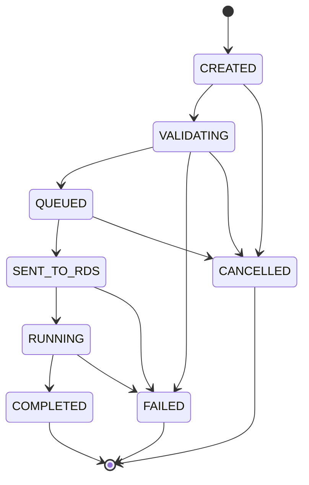

# TKG PDA Phase 03 — Business Workflow Engine

**Status:** Final architecture review passed on `agent/phase-03-workflow-engine`; merge-ready pending human PR approval
**Runtime:** .NET 10 / PostgreSQL 18.3
**Scope:** Domain, application boundary and transactional PostgreSQL persistence only

Phase 03 models TKG logistics independently from RDS. It does not contain an HTTP API, authentication implementation, UI, RDS client, SEER navigation/profile logic or PLC integration.

## Solution structure

| Project | Responsibility |
|---|---|
| `src/TkgPda.Domain` | SQL-aligned enums, state machine, operation/slot/association rules |
| `src/TkgPda.Application` | framework-independent workflow service and persistence port |
| `src/TkgPda.Infrastructure.Postgres` | transactional PostgreSQL implementation, locking and events |
| `tests/TkgPda.Domain.Tests` | state machine and pure business-rule tests |
| `tests/TkgPda.Application.Tests` | command shape and application-boundary tests |
| `tests/TkgPda.Infrastructure.Postgres.Tests` | real PostgreSQL workflow, idempotency and concurrency tests |

`TKG.Pda.slnx`, `global.json` and `Directory.Build.props` define the .NET 10 solution. Warnings are treated as errors.

## SQL states discovered

The existing `ck_transport_status` constraint permits exactly:

```text
CREATED
VALIDATING
QUEUED
SENT_TO_RDS
RUNNING
COMPLETED
FAILED
CANCELLED
```

`SENT_TO_RDS` is retained because it is an existing SQL state. Phase 03 can record the state through a future-executor application boundary for state-machine verification, but performs no RDS or other HTTP call.

## Legal transition table

| Current state | Legal next states | Phase 03 behavior |
|---|---|---|
| `CREATED` | `VALIDATING`, `CANCELLED` | creation transaction advances immediately to validation |
| `VALIDATING` | `QUEUED`, `FAILED`, `CANCELLED` | valid request becomes queued; failure edge is modeled for validation failure reporting |
| `QUEUED` | `SENT_TO_RDS`, `CANCELLED` | Phase 03 stops here during normal request creation; pre-execution cancel is supported |
| `SENT_TO_RDS` | `RUNNING`, `FAILED` | future executor state; no HTTP implementation |
| `RUNNING` | `COMPLETED`, `FAILED` | successful completion applies final slot state; cancellation is deliberately rejected |
| `COMPLETED` | none | terminal |
| `FAILED` | none | terminal; executor failure reconciliation is deferred |
| `CANCELLED` | none | terminal |



## Operation rules

| Operation | Required machine-slot state | Reservation | Successful completion |
|---|---|---|---|
| `BRING_EMPTY` | `VACANT + UNKNOWN` | destination represented by active request; slot state remains unchanged | `OCCUPIED + EMPTY` |
| `REMOVE_FULL` | `OCCUPIED + FULL` | source represented by active request; `FULL` is preserved | `VACANT + UNKNOWN` |
| `REMOVE_EMPTY` | `OCCUPIED + EMPTY` | source represented by active request; `EMPTY` is preserved | `VACANT + UNKNOWN` |

For `BRING_EMPTY`, the machine destination is mandatory and the warehouse source is nullable. A request can reach `QUEUED` without inventing a warehouse slot. Optional supplied endpoints still have to belong to the active machine layout and cannot be `MACHINE` regions.

The 11 Phase 02B rows with `slot_role = 'MACHINE'` are rejected for every operation. They remain display/physical references only. These 11 layout regions are not machine/cell master records: the customer operational scope remains the 9 rows in `master.machines`. UI/API consumers must not derive a machine count from layout-slot regions.

## Cancellation restoration

Cancellation is accepted only from `CREATED`, `VALIDATING` or `QUEUED`:

| Operation | Restored state |
|---|---|
| `BRING_EMPTY` | destination → `VACANT + UNKNOWN`; part/container cleared |
| `REMOVE_FULL` | source → `OCCUPIED + FULL`; current known part/container preserved |
| `REMOVE_EMPTY` | source → `OCCUPIED + EMPTY`; current known part/container preserved |

Because reservation does not mutate occupancy/load, cancellation is deterministic without a reservation snapshot column. Cancellation after dispatch/running is rejected with `CANCELLATION_AFTER_EXECUTION_DEFERRED` and belongs to the future executor/RDS integration.

## Transaction and concurrency model

Request creation is a single PostgreSQL transaction:

1. Acquire a transaction-scoped advisory lock derived from `idempotency_key`.
2. Read and return the existing request when the same key and payload already exist; reject key reuse with a different payload. This replay read takes no request row lock and performs no state mutation.
3. Lock `ops.machine_runtime_state` and validate active machine/variant/layout; navigation remains optional.
4. Validate published variant-layout assignment and known master references.
5. Ensure and lock every supplied `ops.slot_runtime_state` row in deterministic UUID order.
6. Reject disabled, cross-machine, wrong-layout and `MACHINE` endpoints.
7. Reject any active request already using a supplied slot.
8. Validate operation state and explicit part/container conflicts.
9. Insert the request and event trail, then advance `CREATED → VALIDATING → QUEUED`.

The slot row lock serializes two concurrent requests for the same slot. The advisory lock serializes concurrent PDA retries using the same idempotency key; `uq_transport_idempotency` remains the database backstop. No new migration is required.

Every state-mutating workflow transaction uses one global domain row-lock order:

1. `ops.machine_runtime_state` for the request machine.
2. Every source/destination `ops.slot_runtime_state` row, ordered deterministically by UUID.
3. The specific `ops.transport_requests` row, when the request already exists.

Cancellation and execution transitions first perform a non-locking discovery read to obtain immutable machine/endpoint IDs, then acquire the rows in that order and re-read the request with `FOR UPDATE`. They fail closed with `REQUEST_LOCK_SCOPE_CHANGED` if those lock-scope IDs were changed by an out-of-band writer. New request creation follows machine → ordered slots → request insert. Variant switching mutates only machine state, so it takes the machine lock and does not need slot/request locks. The transaction-scoped idempotency advisory lock is a separate pre-domain gate; no other path acquires it, so it cannot invert the domain row-lock hierarchy.

There is no Phase 03 failure-mutation method. `FAILED` transitions are modeled for the future executor, but failure reconciliation remains deliberately unimplemented; therefore there is no active failure path with a competing lock order.

Variant switching locks the same machine runtime row before checking active reservations. Any request in `CREATED`, `VALIDATING`, `QUEUED`, `SENT_TO_RDS` or `RUNNING` blocks the switch. After cancellation/completion, a valid same-machine published assignment can be selected.

## Idempotency payload equivalence

Payload equivalence is an explicit field-by-field comparison. The following persisted command fields must match:

- operation: `TaskType`
- runtime context: `MachineId`, `VariantId`, `LayoutId`, `NavigationProfileId`
- endpoints: `SourceSlotId`, `DestinationSlotId`
- logistics evidence: `ProductGroupId`, `PartId`, `ContainerTypeId`
- persisted request semantics/audit: `Origin`, `RequestedBy`, `Priority`

The lookup key itself, generated request ID/number, timestamps, current status, event data, UI display metadata and other volatile values are not part of equivalence. `Origin`, `RequestedBy` and `Priority` are intentionally included because they alter persisted audit or scheduling semantics; a retry must preserve them. The request model contains no timestamp or arbitrary UI-metadata field that could produce a false `IDEMPOTENCY_KEY_REUSED` result.

## Part and container evidence

- Missing request part/container values are allowed.
- A supplied known master part/container is allowed when the slot evidence is unresolved.
- No relationship or physical footprint is guessed or written back to master data.
- A supplied part conflicting with non-empty source-backed `canonical_part_codes` is rejected.
- A supplied container conflicting with `default_container_type_id` or current known slot state is rejected.
- Unknown master IDs are rejected as impossible references.

## Schema assessment

No blocking schema gap was found and no migration was added.

- Reservation is represented by an active `ops.transport_requests` row rather than a new slot enum value.
- `slot_role`, the idempotency unique index, runtime state and event tables already support the required behavior.
- Warehouse source/destination master data is genuinely absent and therefore remains nullable.
- `navigation_id` remains optional.

The role and active-reservation invariants are guaranteed by the workflow engine transaction. Direct ad-hoc SQL writes to `ops.transport_requests`, `ops.slot_runtime_state` or `ops.machine_runtime_state` could bypass these application invariants; future APIs must call this engine rather than mutating those tables directly.

All four state-changing persistence operations are reachable through `TransportWorkflowService`: create/queue, cancel, execution transition and variant switch. Their SQL helpers are private. `ITransportWorkflowStore` and `PostgresTransportWorkflowStore` must nevertheless remain public for cross-assembly adapter implementation, which means a future API could accidentally inject the persistence port directly and bypass the service-level command guard. The future composition root must expose `TransportWorkflowService` to handlers/controllers and keep the store registration infrastructure-only.

## Validation commands

```powershell
dotnet build TKG.Pda.slnx --configuration Release
dotnet test tests/TkgPda.Domain.Tests --configuration Release
dotnet test tests/TkgPda.Application.Tests --configuration Release
pwsh tests/phase_03/run_postgres_integration.ps1

python -m unittest discover -s tests/phase_02a -p "test_*.py" -v
python -m unittest discover -s tests/phase_02b -p "test_*.py" -v
```

The Phase 03 PostgreSQL runner initializes a fresh PostgreSQL cluster, applies `001 + 002a + 002b`, executes real concurrency tests, confirms that the 11 machine regions are still present, and verifies that no RDS task/worksite was created.

## Validation result

| Suite | Result |
|---|---:|
| .NET Release build | PASS — 0 warnings, 0 errors |
| Domain tests | PASS — 34/34 |
| Application tests | PASS — 9/9 |
| PostgreSQL workflow/concurrency tests | PASS — 20/20 on PostgreSQL 18.3 |
| Phase 02A regression | PASS — 10/10 |
| Phase 02B regression | PASS — 13/13 |
| Phase 02B fresh PostgreSQL/idempotent seed | PASS |

The PostgreSQL workflow suite applies `001 + 002a + 002b`, exercises all three operations and cancellation paths, proves concurrent slot/idempotency behavior, and finishes with `integration.rds_tasks = 0` and `integration.rds_worksites = 0`.

## Final Review / Merge Readiness

The merge-readiness pass found and corrected one actual Phase 03 defect: cancellation and execution-transition transactions previously locked the request before the slot and did not participate in the machine-first hierarchy. All mutating request paths now use machine → UUID-ordered slots → request. No migration or business-state behavior changed.

- Lock-order audit: PASS; first acquired domain row lock is always machine, followed by ordered endpoint slots and then request where applicable.
- Idempotency audit: PASS; exact equivalence fields are fixed above and volatile/UI-only values are excluded.
- Late-cancellation audit: PASS; both `SENT_TO_RDS` and `RUNNING` return the stable `CANCELLATION_AFTER_EXECUTION_DEFERRED` domain code.
- Machine-count audit: PASS; PostgreSQL proves 9 customer machine masters and 11 separate layout `MACHINE` regions.
- Mutation-boundary audit: PASS with the documented future-composition warning; no public SQL helper bypass was found inside the adapter.
- Release build: PASS with 0 warnings and 0 errors.
- Domain tests: PASS — 34/34.
- Application tests: PASS — 9/9.
- PostgreSQL workflow/concurrency tests: PASS — 20/20 on a fresh PostgreSQL 18.3 cluster, including concurrent cancellation versus dispatch.
- Phase 02A regression: PASS — 10/10.
- Phase 02B regression: PASS — 13/13.

No blocker remains for Phase 03 merge. The pull request must remain draft/unmerged until human approval. Phase 04, API, authentication, UI, RDS and PLC work have not started.
