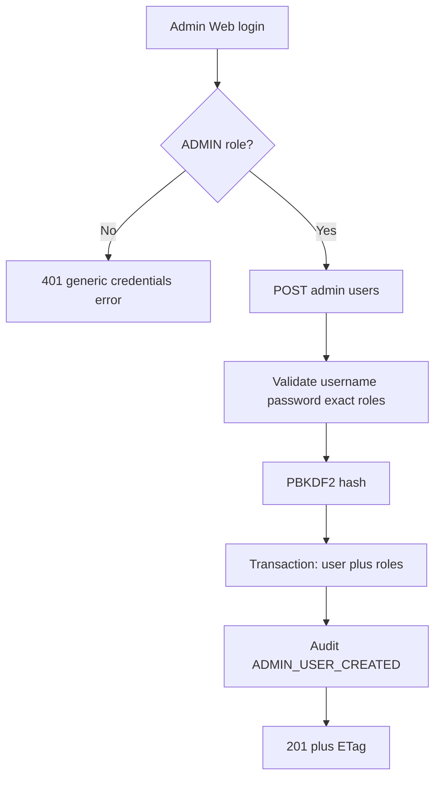
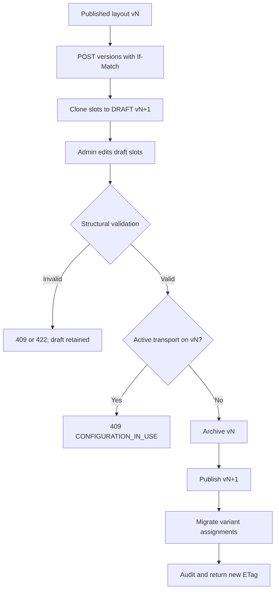
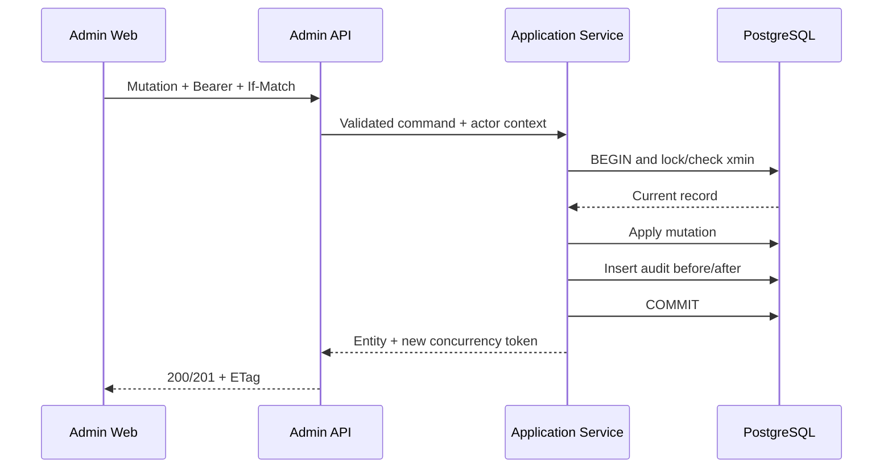
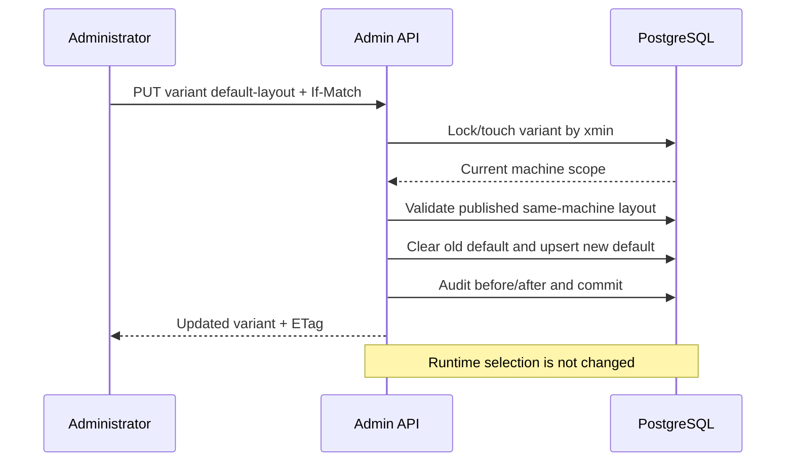

# TKG PDA Phase 05 — Admin Configuration API

**Status:** Accepted; PR #3 merged to `main` at `653df183f1b4d33326ef28f9704753673b5b257a`

**Baseline:** Phase 04 merged to `main` at `92e082f636c5820ddcd5e2ef84668b63dcf74f18`
**Scope:** Admin authentication, provisioning, configuration lifecycle, optimistic concurrency, data-quality visibility and audit API

Phase 05 adds the backend boundary required by the future Admin Web application. It does not add an Admin Web UI, PDA UI, RDS/SEER integration, PLC or SAP behavior. The accepted `001_initial_schema.sql` migration is unchanged.

## Admin architecture

```text
Admin Web JWT
    ↓ ADMIN + client_type=ADMIN_WEB
AdminEndpoints
    ↓ validated HTTP contract + If-Match
AdminConfigurationService
    ↓ framework-independent rules
IAdminConfigurationStore
    ↓ transaction + row lock + audit
PostgresAdminConfigurationStore
```

The query/auth/audit-only `IApiDataStore` remains separate. Operational mutations still cross `TransportWorkflowService`; the admin store does not dispatch, run, complete or fail transport requests and does not write slot or machine runtime state. It reads active operations only to enforce configuration safety.

## Endpoint inventory

### Authentication and visibility

| Method | Endpoint | Purpose |
|---|---|---|
| `POST` | `/api/v1/admin/auth/login` | ADMIN-only, device-less Admin Web JWT |
| `GET` | `/api/v1/admin/roles` | Exact seeded system-role catalogue |
| `GET` | `/api/v1/admin/data-issues` | Derived planning/layout/container quality issues |
| `GET` | `/api/v1/admin/audit-logs` | Filtered audit history; max 500 rows |

### Users, devices and permissions

| Method | Endpoint | Purpose |
|---|---|---|
| `GET/POST` | `/api/v1/admin/users` | List/provision users |
| `PUT` | `/api/v1/admin/users/{userId}` | Profile activation/archive |
| `POST` | `/api/v1/admin/users/{userId}/password-reset` | Administrator-supplied password reset |
| `PUT` | `/api/v1/admin/users/{userId}/roles` | Replace exact role set |
| `GET/POST` | `/api/v1/admin/devices` | List/provision client devices |
| `PUT` | `/api/v1/admin/devices/{deviceId}` | Update/archive device |
| `GET` | `/api/v1/admin/machines` | List nine customer machine masters |
| `PUT` | `/api/v1/admin/machines/{machineId}` | Display metadata and active/archive state |
| `PUT/DELETE` | `/api/v1/admin/users/{userId}/machine-permissions/{machineId}` | Grant/replace or remove relationship |

There is deliberately no machine-create endpoint. The operational customer scope remains the nine proven machine/cell codes; expanding that scope requires an explicit domain decision.

### Variants, layouts and slots

| Method | Endpoint | Purpose |
|---|---|---|
| `GET/POST` | `/api/v1/admin/variants` | List/create variants |
| `PUT` | `/api/v1/admin/variants/{variantId}` | Update/archive variant |
| `PUT` | `/api/v1/admin/variants/{variantId}/default-layout` | Select published same-machine default |
| `GET/POST` | `/api/v1/admin/layouts` | List/create layout draft |
| `POST` | `/api/v1/admin/layouts/{layoutId}/versions` | Clone immutable version into next draft |
| `PUT` | `/api/v1/admin/layouts/{layoutId}` | Rename draft only |
| `POST` | `/api/v1/admin/layouts/{layoutId}/publish` | Validate and publish draft |
| `POST` | `/api/v1/admin/layouts/{layoutId}/archive` | Archive unused layout |
| `GET/POST` | `/api/v1/admin/layouts/{layoutId}/slots` | List/create draft slots |
| `PUT` | `/api/v1/admin/layouts/{layoutId}/slots/{slotId}` | Update or disable draft slot |

### Parts, product groups and containers

| Method | Endpoint | Purpose |
|---|---|---|
| `GET/POST` | `/api/v1/admin/parts` | List/create canonical parts |
| `PUT` | `/api/v1/admin/parts/{partId}` | Update/archive part |
| `GET/POST` | `/api/v1/admin/product-groups` | List/create variant product groups |
| `PUT` | `/api/v1/admin/product-groups/{groupId}` | Update/archive group |
| `PUT/DELETE` | `/api/v1/admin/product-groups/{groupId}/parts/{partId}` | Upsert/remove relationship |
| `GET/POST` | `/api/v1/admin/containers` | List/create container types |
| `PUT` | `/api/v1/admin/containers/{containerId}` | Update/archive container |

## Role and operation matrix

| Capability | ADMIN Web | ADMIN PDA | SUPERVISOR PDA | LINE_OPERATOR PDA | WAREHOUSE_OPERATOR PDA |
|---|---:|---:|---:|---:|---:|
| Admin configuration API | Yes | No | No | No | No |
| Read operator context | Yes | Yes | Yes | permission | permission |
| Runtime variant selection | No | permission bypass | `can_change_variant` | No | No |
| `BRING_EMPTY` | No | Yes | `can_operate` | `can_operate` | `can_operate` |
| `REMOVE_FULL` | No | Yes | `can_operate` | `can_operate` | No |
| `REMOVE_EMPTY` | No | Yes | `can_operate` | `can_operate` | No |
| Cancel transport | No | Yes | `can_operate` | `can_operate` | own `BRING_EMPTY` only |

An account may have multiple roles. A warehouse restriction applies only when the account has no ADMIN, SUPERVISOR or LINE_OPERATOR role. Machine permission checks remain mandatory for non-ADMIN users.

## PDA versus Admin Web authentication

- `/api/v1/auth/login` accepts an active `PDA` record and issues `client_type=DEVICE_BOUND` with `device_id` and `device_code` claims.
- Every PDA request repeats `X-Device-Code`; middleware matches it to the token and rechecks device activation.
- `/api/v1/admin/auth/login` accepts only an active user with `ADMIN`; it requires no physical device record and issues `client_type=ADMIN_WEB` without device claims.
- Admin endpoints require both ADMIN and `client_type=ADMIN_WEB`.
- Operator mutation endpoints require `client_type=DEVICE_BOUND`; a device-less Admin Web token cannot initiate transport or runtime variant selection.
- PDA login rate limit is 10/minute per IP/device. Admin Web login has a separate 30/minute per-IP partition.

## User provisioning and password reset

- Usernames are trimmed and normalized to lowercase.
- At least one of the four seeded role codes is required; arbitrary role creation is not exposed.
- Passwords must contain 12–256 characters and are stored with the Phase 04 PBKDF2-HMAC-SHA512 format.
- Neither create nor reset responses return hashes.
- Password-reset audit contains only `passwordReset=false/true`; password/hash material is excluded.
- The current administrator cannot deactivate its own account or remove its own ADMIN role.
- `must_change_password`, password history, reset-token delivery and session revocation are not representable in the current schema.



## Device provisioning

Device records use the schema's `PDA`, `ADMIN_WEB`, `SERVICE` and `OTHER` types. Only type `PDA` is accepted by the field login endpoint. Archiving a PDA immediately blocks new logins and invalidates existing device-bound requests at the next active-device check. Device codes identify a managed client but are not authentication secrets.

## Machine permissions

`can_view`, `can_operate`, `can_change_variant` and `can_manage_slots` are replaced atomically per user/machine. Permission changes use the user ETag so simultaneous role/permission edits cannot silently overwrite each other. Removing a permission is the only hard delete in this area because it removes a relationship/grant, not a historical master entity. ADMIN keeps the Phase 04 global machine-permission bypass.

## Configuration lifecycle

### Variants

- Variant code is immutable after creation; name, order and active state are mutable.
- Archive is blocked while the variant is selected by runtime or referenced by an active transport.
- Default layout must be published and belong to the same machine.
- Changing the default does not change `ops.machine_runtime_state`; runtime selection remains behind `TransportWorkflowService`.

### Layout draft, publish and version rules

- A machine/code may have at most one draft at a time.
- Published and archived layout rows and their slots are immutable.
- New versions are cloned from a non-draft source; version is `max(version)+1` and slots are copied with new IDs.
- Publish requires at least one enabled non-MACHINE slot and complete normalized 0–1 display geometry on every enabled slot.
- Unresolved part/container evidence remains visible but does not block publication; values are never guessed.
- Publishing a replacement archives the previous published machine/code version and migrates its variant-layout assignments while preserving default flags.
- Replacement publish is blocked while the previous version has an active transport.
- If the previous version is the current runtime layout but has no active transport, publication may proceed; an authorized device-bound operator must explicitly switch runtime to the new published version before new requests can use it.
- Explicit archive is blocked while the layout is current runtime or referenced by an active transport.



### Slot management

- Slot code is immutable inside a version; correcting identity requires a new slot/version.
- Geometry is either entirely NULL or a positive rectangle inside normalized 0.0–1.0 bounds.
- Unknown physical millimetre footprint is unrelated to display geometry and is never inferred.
- `MACHINE` regions are valid display records but remain non-transport positions.
- Slots are archived by `is_enabled=false`; there is no slot hard-delete endpoint.
- A slot update supplies the slot `If-Match` plus `X-Layout-Version` for the parent draft.

## Parts, product groups and containers

- Canonical part/container codes are normalized to uppercase and immutable after creation.
- Parts may be shared across variants/product groups as allowed by the frozen schema.
- Product-group part `containerTypeId` and `lotQuantity` remain nullable; unknown evidence is not invented.
- Known container dimensions/capacity must be positive. Unknown values remain NULL.
- Archiving is blocked when an entity is present in active transport/runtime state. Container archive is also blocked when used as an enabled published-slot default.

## Data-quality visibility

`GET /api/v1/admin/data-issues` derives read-only issue rows from proven DB evidence:

- non-empty planning `source_note`
- unknown container footprint dimensions
- unresolved slot part association
- unresolved slot container association
- MEDIUM/LOW physical-layout confidence

The frozen schema has no first-class issue status, assignee, resolution note or acknowledgement table. Therefore Phase 05 exposes the evidence but does not pretend that issues can be resolved in the database.

## Audit model

Every admin mutation writes `audit.audit_logs` inside the same PostgreSQL transaction as the configuration change. Records contain actor, action, entity, safe before/after JSON, IP, user agent and correlation ID. Password/hash material is never included. Login success/failure uses the existing auth audit port.





## Delete and archive policy

Master entities and user/device records use `is_active`, `is_enabled` or layout `ARCHIVED`; no hard-delete endpoint exists for users, devices, machines, variants, layouts, slots, parts, product groups or containers. Hard delete is allowed only for replaceable relationship rows such as a machine permission or product-group part link. FK restrictions remain a final database guard.

## Optimistic concurrency

The frozen master schema lacks a common `row_version`. Phase 05 exposes PostgreSQL `xmin` as an opaque numeric `concurrencyToken` and quoted HTTP `ETag`. Mutations require `If-Match`; missing preconditions return `428 IF_MATCH_REQUIRED`, malformed tokens return `400`, and stale tokens return `409 CONCURRENCY_CONFLICT`. Clients must not calculate or persist semantic meaning from the token.

`xmin` is adequate for the current single-cluster API but is a known portability limitation. A future migration should add explicit bigint row versions before logical replication, cross-database migration or long-lived offline editing.

## Validation

| Suite | Result |
|---|---:|
| Release build | PASS — 0 warnings, 0 errors |
| Mermaid documentation flows | PASS — 4/4 parsed and rendered with Mermaid CLI |
| Authentication/security unit tests | PASS — 14/14 |
| Admin HTTP/PostgreSQL 18.3 tests | PASS — 20/20 |
| Phase 04 authenticated operator regression | PASS — 19/19 on PostgreSQL 18.3 |
| Phase 03 domain/application/workflow regression | PASS — 34/34 + 9/9 + 20/20 on PostgreSQL 18.3 |
| Phase 02A regression and two-run seed integration | PASS — 10/10; second import changed no logical state |
| Phase 02B regression and two-run seed integration | PASS — 13/13; second import changed no logical state |

The Phase 05 suite validates Admin/PDA token separation, provisioning, password secrecy, device revocation, machine permissions, warehouse operation restrictions, stale ETags, draft/publish/version rules, assignment migration, active-operation blocking, nullable evidence, data-quality visibility and atomic audit.

## Known schema limitations

- no refresh/session/revocation table or Admin Web cookie session
- no persistent/distributed login lockout state
- no user-device assignment table
- no password history, password-changed time or must-change flag
- no explicit master-data row-version columns; `xmin` is used as an opaque token
- no first-class data-issue resolution workflow
- no layout change-set/review/approval entity; ADMIN publishes directly
- no archive timestamp/reason fields on most `is_active` entities; audit supplies event history
- no machine-master creation workflow; customer scope stays at nine

Phase 05 stops here. Admin Web, PDA UI, RDS, SEER navigation, PLC and SAP have not started.
