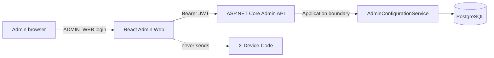

# TKG PDA Phase 06 — Admin Web

**Status:** Implemented on `agent/phase-06-admin-web` (PR #4); Phase 06.1 security & acceptance hardening applied — memory-only access token and real-browser acceptance suite

**Baseline:** Phase 05 merged to `main` at `653df183f1b4d33326ef28f9704753673b5b257a`

**Scope:** React/TypeScript administration client for the accepted Phase 05 API

Phase 06 adds the browser application used to administer identities, machine permissions and versioned customer configuration. It consumes the existing HTTP boundary and adds no database migration or backend mutation path. Flutter PDA, RDS, SEER navigation/map, PLC and SAP remain outside this phase.

## Architecture



The application is in `src/TkgPda.AdminWeb` and uses:

- React 19 with strict TypeScript;
- Vite for development and production bundling;
- React Router for protected client routes;
- TanStack Query for server-state loading, invalidation and mutation refresh;
- a typed `fetch` client for the Phase 05 contracts;
- Lucide icons and repository-owned CSS with no runtime font/CDN dependency;
- Vitest/Testing Library for unit and component tests;
- Playwright/Chromium for end-to-end browser tests.

Production deployments must serve the static build and proxy `/api` and `/health` to `TkgPda.Api` over the same trusted origin. The Vite proxy is development-only.

## Authentication and JWT storage

- Login uses `POST /api/v1/admin/auth/login` and does not request `X-Device-Code`.
- Only a response with `clientType = ADMIN_WEB` and the `ADMIN` role is accepted by the client.
- **The bearer JWT is held only in application runtime memory (React state).** It is never written to `localStorage`, `sessionStorage`, `IndexedDB`, cookies, the URL/query string, source code or build-time environment files, and is never logged to the console.
- Because the token is memory-only, **a full browser refresh discards the session and returns the operator to `/login`. This is intentional:** the accepted Phase 05 auth schema has no refresh-token or server-side session model, so no persistence or silent re-authentication is attempted.
- The session is also cleared on explicit logout, at `expiresAt`, and after an authenticated `401` response. Clearing the token additionally clears the authenticated user and the relevant TanStack Query cache so no stale authenticated UI remains.
- No browser-side mechanism can replace API authorization. Every request is re-authorized by Phase 05.
- Login failures show a generic message and never disclose whether the username or password was wrong.

Keeping the token out of every web store removes the persisted-token XSS exfiltration surface entirely; the trade-off — re-login after refresh — is accepted for Phase 06. Production hosting must still enforce HTTPS, a restrictive Content-Security-Policy, no third-party scripts and normal dependency/security patching. Server-side revocation is not representable in the current auth schema.

## Route inventory

| Route | Screen | Main capability |
|---|---|---|
| `/login` | Admin login | Device-less `ADMIN_WEB` session |
| `/` | Dashboard | Counts, configuration health, recent audit and data issues |
| `/users` | Users & permissions | Provisioning, profile/archive, roles, password reset, machine matrix |
| `/devices` | Devices | PDA/web client provisioning, metadata and archive |
| `/machines` | Machines & variants | Nine-machine scope, variant lifecycle and default published layout |
| `/layouts` | Layouts | Create, rename, clone, publish, archive and open editor |
| `/layouts/:layoutId/editor` | Normalized layout editor | Slot geometry, role, container evidence and load flags |
| `/catalog` | Parts & product groups | Canonical parts, variant groups and group-part planning links |
| `/containers` | Containers | Category, nullable footprint/capacity and archive |
| `/data-quality` | Data quality | Read-only issue summary and filters |
| `/audit` | Audit history | Actor/entity filters and before/after JSON evidence |

Unknown routes render an in-application not-found state. All non-login routes require an in-memory valid session and redirect to `/login` otherwise.

## Administration behavior

### Dashboard

The dashboard derives its values from live API responses. It distinguishes the nine customer machine masters from layout regions of role `MACHINE`; no count is synthesized from the 11 display regions. It shows active users, published/draft layouts, device health, canonical parts, missing container footprint data, recent audit entries and priority data issues.

### Users, roles and machine permissions

The UI displays exactly the four seeded roles returned by the API: `ADMIN`, `SUPERVISOR`, `LINE_OPERATOR` and `WAREHOUSE_OPERATOR`. It supports individual account provisioning, profile activation/archive, role replacement and administrator-supplied password reset. Password inputs are never repopulated or rendered in audit data.

The machine permission matrix controls `can_view`, `can_operate`, `can_change_variant` and `can_manage_slots`. ADMIN global machine access is explicitly labelled and its row controls are disabled because stored matrix values do not restrict ADMIN. The backend remains authoritative for warehouse operation restrictions.

### Devices

Administrators can provision and update device code, name, type, active state and JSON metadata. Archive is expressed as `isActive = false`; hard delete is not exposed. Admin Web login itself remains device-less.

### Machines and variants

The page operates only on the nine proven machine masters; it does not expose machine creation. Variants can be created, updated and archived. A variant default can be assigned only from published layouts returned for the same machine; server validation remains authoritative.

### Layout lifecycle

- New layouts are drafts.
- Only drafts can be renamed or edited.
- Publishing and archiving are explicit actions with confirmation copy.
- Published/archived versions are immutable in the editor.
- A new editable version is created by clone; published rows are never overwritten.
- Shared variant-to-layout relationships are preserved by the API model; the UI does not manufacture a second physical layout.

## Normalized 2D layout editor

The editor is a display/physical-reference surface. It prominently states **“Robot Haritası Değildir”** and explains that it does not produce robot X/Y, waypoint, route, map, navigation-profile or stitch configuration.

Supported editor behavior:

- 0.0–1.0 normalized `x`, `y`, `width`, `height` geometry;
- pointer drag and resize with selectable grid snapping;
- keyboard arrow nudge, with Shift for a larger step;
- zoom, slot-role legend, role-specific styling and enabled/disabled state;
- client-side overlap highlighting without automatic repositioning;
- inspector editing for display name, role, default container, order and load flags;
- slot creation only on draft layouts;
- NULL geometry preservation and an explicit user action before placing such a slot;
- `MACHINE` regions are visibly labelled **“taşıma dışı”** reference areas and are not treated as transport endpoints;
- unknown container footprint values stay NULL; category never generates guessed dimensions.

The editor exposes only the schema-backed slot roles: `MACHINE`, `STAGING`, `EMPTY_STORAGE`, `FULL_STORAGE`, `WAREHOUSE`, `PICKUP`, `DROP`, `SHARED` and `OTHER`. Container category and product-group relation controls likewise use the exact Phase 05 allow-lists; the client cannot invent an unsupported enum value through these forms.

Client-side checks improve feedback but do not replace Phase 05 publish validation.

## Optimistic concurrency and errors

Entity mutations send `If-Match: "<concurrencyToken>"`. Slot updates additionally send `X-Layout-Version: "<layout concurrencyToken>"`, protecting both the slot row and its parent draft. After every mutation attempt the relevant query is invalidated and refreshed.

Non-success responses are parsed as RFC-style ProblemDetails. The UI shows the stable error code and correlation ID. `409 + CONCURRENCY_CONFLICT` receives dedicated copy explaining that another administrator changed the record; the conflicting write is not retried or applied, and the UI offers an explicit **“Sunucudan yeniden yükle”** action. The client never auto-retries mutations.

## Audit and data quality

Audit history is read-only and supports actor/entity filters, bounded result count and expandable before/after JSON. The data-quality screen groups and filters the Phase 02A/02B/05 issues and does not offer “fix by guessing” actions. Source discrepancies, formula errors, missing planning inputs and unknown physical footprints remain visible.

## Development and validation

```powershell
cd src/TkgPda.AdminWeb
npm ci
npm run dev

npm run typecheck
npm run lint
npm run test:run
npm run test:e2e
npm run build
```

`VITE_TKG_API_TARGET` is not embedded into the application. For local proxy selection set the process environment variable `TKG_API_TARGET`; the default is `http://localhost:5000`.

### Real-browser acceptance harness

`npm run test:e2e` is self-provisioning. Playwright global setup (`e2e/global-setup.ts`) initializes a throwaway PostgreSQL 18 cluster, applies the authoritative `db/migrations/001_initial_schema.sql` baseline plus the Phase 02A/02B seeds, seeds a single isolated `ADMIN` identity, builds and starts the real `TkgPda.Api` (Release), and waits for `/health/ready`. The Vite server proxies `/api` to that API, and real Chromium drives the real React client. Global teardown stops the API, stops PostgreSQL and removes the temp cluster and ignored runtime handoff. The admin password and JWT signing key are randomly generated per run, exist only for the isolated runtime, and are never production configuration or committed source values. The PostgreSQL binary directory can be overridden with `TKG_PG_BIN` (default `C:\Program Files\PostgreSQL\18\bin`).

Validation results:

| Check | Result |
|---|---|
| TypeScript project build | PASS |
| Oxlint | PASS |
| Vitest unit/component | 23/23 PASS in 5 files |
| Playwright Chromium E2E (real API + PostgreSQL 18.3) | 19/19 PASS |
| Vite production build | PASS, 365.80 kB JS / 108.60 kB gzip |
| Domain / Application / Auth unit regression | 34/34, 9/9, 14/14 PASS |
| Phase 03 PostgreSQL workflow/concurrency | 20/20 PASS on PostgreSQL 18.3 |
| Phase 04 PostgreSQL authenticated API | 19/19 PASS on PostgreSQL 18.3 |
| Phase 05 PostgreSQL Admin API | 20/20 PASS on PostgreSQL 18.3 |
| Phase 02A / 02B baseline | unchanged (no schema/seed files modified in Phase 06.1) |
| npm vulnerability audit | 0 known vulnerabilities |
| NuGet vulnerable-package audit | 0 vulnerable direct/transitive packages across the solution |

Unit tests cover memory-only token handling (no `localStorage`/`sessionStorage`/`IndexedDB` persistence, logout/401/expiry clearing), cache clearing between principals, typed HTTP headers/errors, exact schema enum rendering, permission behavior and normalized editor behavior.

The 19 real-browser scenarios cover: (01) device-less ADMIN_WEB login; the token-storage security proof (token only in memory — never in web storage, IndexedDB, cookies, URL or console); (15) refresh-forces-relogin; (14) logout clears state and blocks protected routes; the unauthenticated-route guard; (401) server-rejection clears state; (02) dashboard real backend data; (03) create user with no password in the DOM; (04) change role; (05) modify machine permission; (06) register PDA device; (07) deactivate PDA device; (13) read-only data-quality evidence; (08) create DRAFT layout; (09) edit/save a slot; (10) a second real ADMIN_WEB API actor creates a stale ETag, the conflict UX preserves the newer value and offers refetch; (11) publish; (12) resulting audit entry; and layout-editor acceptance on a seeded published layout (MACHINE region + logistics slots render, MACHINE is visibly transport-excluded, published is read-only, draft is editable, normalized geometry is bounded, and “Robot Haritası Değildir” is visible).

Generated `node_modules`, `dist`, coverage, Playwright reports, test results, screenshots and `.env*` are ignored and must not be committed.

## Known limitations

- There is no refresh-token or server-side session-revocation model in the accepted schema. The Admin Web token is therefore memory-only and a browser refresh intentionally requires re-login; no refresh-token/session infrastructure exists or is introduced by Phase 06.
- The application is not yet packaged behind a production reverse proxy with final CSP/security headers.
- Pagination is not available in the current Phase 05 list contracts; screens use client-side search/filtering.
- Layout editing saves one slot at a time; there is no bulk transactional canvas save or undo history.
- Backend write responses do not expose `to_row_version` audit linkage; audit still records the mutation evidence.
- Physical footprint values remain unknown where customer evidence is absent.
- Phase 06 contains no operator/PDA transport workflow, RDS callback, SEER route/map, PLC or SAP behavior.

## Phase boundary

Phase 06 stops at the Admin Web draft PR. Phase 07 Flutter PDA and all robot/integration phases have not started.
