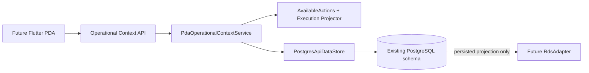

# TKG PDA Phase 07A — PDA + RDS Contract Readiness

**Durum:** Uygulandı; draft PR doğrulaması

**Baseline:** Phase 06, `main` dalına `bd61843824496cf2bf7dd48607ee4aa512f583e3` merge commit'iyle alındı

**Kapsam:** Mevcut operational-context endpoint'inin PDA read model'ı ve kalıcı RDS projeksiyonu için genişletilmesi

Phase 07A, gelecekteki Flutter istemcisinin iş kuralı kopyalamadan tüketebileceği HTTP sözleşmesini hazırlar. Canlı RDS adapter'ı, Flutter, SEER navigation/map, PLC ve SAP içermez. `001_initial_schema.sql` ile iki müşteri seed'i değişmeden kullanılmış, migration eklenmemiştir.

## Mimari

Mevcut `GET /api/v1/machines/{machineId}/operational-context` endpoint'i korunmuştur. Infrastructure ham DB read model'ını döndürür; application katmanı rol, cihaz, makine yetkisi, slot durumu ve aktif talep kanıtıyla PDA'ya güvenli projection üretir. API domain davranışını veya PostgreSQL state'ini bypass etmez.

## Sözleşme ekleri

Operational context artık mevcut machine/variant/layout/navigation/slot alanlarına ek olarak şunları taşır:

- yalnız aktif variant'ın aktif product group kayıtları, main part ve aktif alt/ilişkili part'ları;
- aktif machine talepleri (`CREATED`, `VALIDATING`, `QUEUED`, `SENT_TO_RDS`, `RUNNING`), talep sahibi ve `isMine`;
- slot başına kalıcı RDS WorkSite projeksiyonu ve ayrı execution readiness;
- slot başına yapılandırılmış `availableActions`;
- aktif variant için mevcut task-template/readiness kanıtı;
- aktif talep üzerinde kararlı PDA execution/failure/cancellation projeksiyonu.

Nullable `containerTypeId`, `containerCode` ve `lotQuantity` aynen korunur. Bilinmeyen container, part, WorkSite ID veya task label üretilmez.

## AvailableActions semantiği

Her slot için tam üç action değerlendirilir:

- `BRING_EMPTY`: `VACANT + UNKNOWN`
- `REMOVE_FULL`: `OCCUPIED + FULL`
- `REMOVE_EMPTY`: `OCCUPIED + EMPTY`

Projection her action için `enabled`, `disabledCode` ve kullanıcıya dönük `disabledMessage` sağlar. Değerlendirme sırası device-bound PDA, rol, machine permission, `MACHINE` rolü, slot enabled, aktif talep/busy ve exact slot state kontrolleridir.

Rol sonucu:

| Kimlik | Bring | Remove | Cancel |
|---|---:|---:|---:|
| device-bound `ADMIN` | Evet | Evet | execution öncesi |
| device-bound `SUPERVISOR` | Evet | Evet | execution öncesi |
| device-bound `LINE_OPERATOR` | machine `can_operate` ile | machine `can_operate` ile | execution öncesi |
| device-bound `WAREHOUSE_OPERATOR` | machine `can_operate` ile | Hayır | yalnız kendi `BRING_EMPTY`, execution öncesi |
| `ADMIN_WEB` | Hayır | Hayır | Hayır |

`slot_role=MACHINE` için bütün action'lar `MACHINE_REGION_FORBIDDEN` ile disabled olur. Aktif talebin source/destination yaptığı slot `SLOT_BUSY` olur; occupancy'ye `RESERVED` eklenmez. WorkSite mapping yokluğu iş action'ını yeniden yazmaz; ayrı `RDS_WORKSITE_NOT_MAPPED` readiness sinyalidir.

## Aktif talep ve cancellation projeksiyonu

Operational projection historical `COMPLETED`, `FAILED` ve `CANCELLED` talepleri dışarıda bırakır. Aktif kayıtta request numarası/operation/status, kullanıcı kanıtı, source/destination, group/part/container, priority, zaman, cancellation policy ve execution yer alır.

`SENT_TO_RDS` veya `RUNNING` sonrasında PDA cancel açık gösterilmez; sabit `CANCELLATION_AFTER_EXECUTION_DEFERRED` kodu kullanılır. Gerçek `/api/stop-task` ve failure/cancellation slot reconciliation Phase 08'e ertelenmiştir.

## RDS WorkSite projeksiyonu

`integration.layout_slot_rds_mapping` ile `integration.rds_worksites` yalnız okunur. Dönen alanlar: `isMapped`, `siteId`, `area`, `groupName`, `type`, `filled`, `locked`, `disabled`, `syncFailed`, `content`, `agvId`, `lastSyncAt`.

- Eşlenmiş WorkSite değerleri DB'deki persisted kanıttan birebir gelir.
- Eşlenmemiş slot `isMapped=false` ve nullable alanlarla dürüstçe temsil edilir.
- Slot kodundan site ID türetilmez; ağ sorgusu/yazması yapılmaz.

## Execution ve failure projeksiyonu

`ops.transport_requests` ile varsa `integration.rds_tasks`, status enum değiştirilmeden `REQUESTED`, `QUEUED`, `WAITING_FOR_ROBOT`, `ROBOT_ASSIGNED`, `RUNNING`, `WAITING`, `COMPLETED`, `FAILED`, `TERMINATED` durumlarına projekte edilir. RDS `1000` tek başına hareket sayılmaz; `agvId` atamayı, `startedAt` yürütme kanıtını güçlendirir. Terminal TKG business state önceliklidir.

`60008/fail_lock_bin`, `60009/no_path`, `60011/task_failed` güvenli sırasıyla `WORKSITE_BUSY`, `PATH_UNAVAILABLE`, `EXECUTION_FAILED` kodlarına çevrilir. `54002/54003`, `TRAFFIC_WAITING + WAITING` olarak kalır. Raw teknik ayrıntı normal operatöre gösterilmez; correlation ID korunur.

## Task-template readiness

Aktif `master.task_templates` kayıtları variant, optional product group, task type/operation, source/destination slot-group ID, nullable `rdsTaskLabel`, `rdsTaskLabelConfigured` ve priority ile döner. Eşleşen template/label yokluğu görünür kalır. Phase 07A global label hard-code etmez ve dispatch yapmaz.

## Test kanıtı

| Katman | Kapsam | Sonuç |
|---|---|---|
| Application | action/role/busy/MACHINE, mapping, execution ve failure projection | 32/32 PASS |
| Phase 07A PostgreSQL API | product-group/NULL, role actions, active request/isMine/history, WorkSite/RDS task/template | 4/4 PASS, PostgreSQL 18.3 |
| Domain | frozen workflow/state-machine | 34/34 PASS |
| Auth | password/JWT/device security | 14/14 PASS |
| Phase 03 PostgreSQL | workflow/concurrency | 20/20 PASS, PostgreSQL 18.3 |
| Phase 04 PostgreSQL | authenticated operator API | 19/19 PASS, PostgreSQL 18.3 |
| Phase 05 PostgreSQL | Admin Configuration API | 20/20 PASS, PostgreSQL 18.3 |
| Phase 02A | pipeline + fresh PostgreSQL/idempotency | 10/10 PASS + integration PASS |
| Phase 02B | pipeline + fresh PostgreSQL/idempotency | 13/13 PASS + integration PASS |
| Release build / format | .NET solution | PASS, 0 warning/error; format clean |

PostgreSQL suite'leri ardışık çalıştırılmıştır. Phase 02A/02B testleri normalize çıktının deterministik ve müşteri kaynaklarının byte-identical kaldığını doğrular. `001_initial_schema.sql`, `002a_customer_textual_master_data.sql`, `002b_customer_physical_layouts.sql` ile `data/generated` baseline'ında diff yoktur. Phase 07A acceptance catalog kontrolünde 9 machine master, 0 `RESERVED` occupancy ve 0 canlı RDS credential doğrulanmıştır.

## Bilinen sınırlar ve ertelenen işler

- Şemada RDS `lockedBy` için ayrı typed kolon yoktur; Phase 07A alan uydurmaz. Gerekirse gerçek payload kanıtıyla Phase 08'de değerlendirilir.
- Baseline customer seed task template veya RDS WorkSite eşlemesi sağlamaz. Konfigürasyon yokluğu readiness olarak görünür.
- Persisted RDS projection canlı verinin güncelliğini garanti etmez; `lastSyncAt/syncFailed` kanıtı tüketiciye açıktır.
- Full alarm ingestion/localization, callback güvenliği, reconciliation polling, Wind Task create/query/stop ve failure slot reconciliation Phase 08 kapsamıdır.
- Flutter/Dart/Android/iOS uygulaması Phase 07B kapsamıdır ve bu branch'te başlatılmamıştır.
- Normalize `ui_*` geometri robot/RDS/map koordinatı değildir.

Normative entegrasyon kararları [RDS_PDA_INTEGRATION_SPEC.md](RDS_PDA_INTEGRATION_SPEC.md) belgesindedir.
