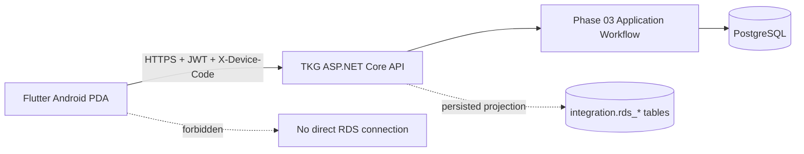
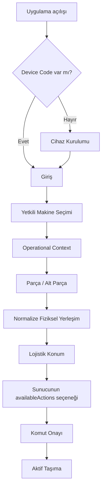

# TKG PDA — Phase 07B Flutter PDA Application

Phase 07B, TKG operatörlerinin Android endüstriyel PDA cihazlarından güvenli lojistik talebi oluşturduğu gerçek Flutter istemcisini ekler. Uygulama yalnız TKG ASP.NET Core API ile konuşur; iş kuralları, yetkilendirme, slot uygunluğu ve execution projeksiyonunda backend otoritedir.

## 1. Mimari ve hedef cihaz

Uygulama `src/TkgPda.Pda` altında Flutter 3.44.8 / Dart 3.12.2 ile geliştirilmiştir. Birincil hedef Android endüstriyel PDA'dır. Material 3 arayüzü büyük dokunma alanları, yüksek kontrast, belirgin seçili/disabled durumlar, Türkçe operatör metinleri ve portrait/landscape uyumlu yerleşim kullanır.

Katmanlar:

- `app/`: composition root, router, lifecycle, theme ve ekranlar arası state koordinasyonu.
- `core/`: memory-only oturum, build-time konfigürasyon, merkezi HTTP/ProblemDetails ve secure storage sınırı.
- `data/`: frozen API modelleri ve repository endpoint adaptasyonu.
- `features/`: cihaz kurulumu, login, makine seçimi, normalize layout/operasyon ve transport submission.
- `shared/`: güvenli operatör sunum metinleri ve ortak feedback bileşenleri.

Firebase, yerel DB, offline command queue, analytics, RDS SDK veya cloud bağımlılığı eklenmemiştir.

## 2. Cihaz kurulumu ve kimlik doğrulama

İlk açılışta Admin Web'de önceden provision edilmiş Device Code girilir ve `flutter_secure_storage` içine yalnız bu değer yazılır. Uygulama cihaz kaydı oluşturmaz. Device Code değiştirme akışı önce mevcut oturumu kapatır.

Kullanıcı adı ve parola her login sırasında girilir. Parola yalnız repository metodunun çağrı argümanıdır; controller/session alanında tutulmaz, persistent store'a yazılmaz ve loglanmaz. JWT yalnız `SessionMemory` içinde bulunur:

- secure storage, SharedPreferences, dosya, URL veya DB'ye yazılmaz;
- process restart sonrasında geri gelmez ve login zorunlu olur;
- logout/401, JWT, current user ve operasyonel cache'i temizler;
- Device Code logout/401 sonrasında korunur.

Login dahil cihaz-bağlamlı bütün API isteklerine merkezi client `X-Device-Code` ekler. Authenticated çağrılar ayrıca memory'deki Bearer token'ı kullanır. Password, JWT ve Authorization header için hiçbir uygulama logu yoktur.

## 3. Konfigürasyon ve HTTP sınırı

API adresi `--dart-define=TKG_API_BASE_URL=https://...` ile verilir ve yalnız HTTP(S) URI kabul edilir. Üretim müşteri IP'si veya credential source içinde yoktur. Android main manifest yalnız INTERNET izni taşır; cleartext trafik sadece debug manifestte yerel geliştirme için açıktır. Kamera/barkod izni eklenmemiştir.

Merkezi ProblemDetails katmanı 400, 401, 403, 404, 409, 422, 428, 429, 500 ve 503 durumlarını güvenli Türkçe UX'e çevirir; stable code, detail ve correlation ID korunur, stack trace gösterilmez. 409 gerekli olduğunda context refetch tetikler. Timeout/client/socket hataları read için offline, mutation için sonucu belirsiz istek olarak ayrılır.

## 4. Operatör akışı

Makine listesi yalnız `GET /api/v1/machines` sonucundan oluşur; canonical dokuz kod Flutter'da hard-code edilmez. Makine seçimi `operational-context` okuma modelini getirir. Aktif variant belirgin gösterilir. Backend `canChangeVariant` capability verdiğinde onaylı variant/layout seçimi yapılır; başarı sonrası stale seçimler atılıp context bütünüyle yenilenir. Flutter role göre izin üretmez.

Product Group ekranda **Parça**, child evidence kayıtları **Alt Parçalar** olarak gösterilir. Komutlarda display string parse edilmez, yalnız API ID'leri kullanılır. `containerTypeId` ve `lotQuantity` gibi eksik kanıt `NULL` olarak korunur ve **Tanımlı değil** gösterilir; değer tahmin edilmez.

## 5. Layout ve slot davranışı

`ui_x`, `ui_y`, `ui_width`, `ui_height` yalnız 0–1 normalize ekran geometrisidir. Ekran kalıcı olarak bunun robot/RDS/SEER/map koordinatı olmadığını belirtir. Layout zoom/pan destekler; edit, drag ve resize içermez.

`slot_role = MACHINE` bölgeleri farklı renkte **Makine Alanı** olarak çizilir, semantics olarak operation button değildir ve tap ile transport seçilemez. Geometrisi kanıtlanmayan kayıtlar tahmin edilmeden ayrı listelenir. Lojistik slot detayında occupancy/load, part/container evidence, busy/reservation ve persisted RDS readiness operatör-dostu metinlerle sunulur.

## 6. Transport ve availableActions

Flutter BRING/REMOVE uygunluğu hesaplamaz; `availableActions` birebir tüketilir. Disabled server action gönderilemez ve server sebebi gösterilir.

| İşlem | Türkçe UI | Kaynak | Hedef |
|---|---|---|---|
| `BRING_EMPTY` | Boş Kasa Getir | `NULL` | seçili slot |
| `REMOVE_FULL` | Dolu Kasayı Kaldır | seçili slot | `NULL` |
| `REMOVE_EMPTY` | Boş Kasayı Kaldır | seçili slot | `NULL` |

Komut onayı makine, variant, Parça, Alt Parça, slot ve işlemi sabitler. Sadece API'de kanıtlanan machine/variant/layout/navigation profile/product group/part/container ID'leri gönderilir; bilinmeyen ID üretilmez.

Her maddi komut için bir UUID idempotency key oluşturulur. Aynı komutun belirsiz retry'ı aynı key'i kullanır; maddi payload değişikliği yeni key üretir. In-flight guard çift dokunmanın ikinci HTTP isteğini başlatmasını engeller. Timeout sonrası yeni key otomatik üretilmez: operatör aynı key ile retry veya context/active-request refetch yapar.

## 7. Offline, polling ve lifecycle

Offline command queue yoktur. Backend ulaşılamadığında son memory view açıkça **Bağlantı yok — bilgiler güncel olmayabilir** işaretiyle tutulabilir; transport, variant switch ve diğer mutation'lar kapatılır. Bağlantı dönünce context yenilenmeden mutation açılmaz.

Operasyon ekranı aktif request varken 4 saniye, yokken 15 saniye aralıkla tek ve çakışmayan context refresh planlar. Background'da polling durur ve otomatik command gönderilmez. Resume sırasında `/auth/me` ile oturum, ardından makine/context yeniden doğrulanır. Process restart JWT'yi kaybettiği için login'e döner.

## 8. Execution, failure ve cancellation UX

Aktif taşıma kartı backend execution projection'ındaki `REQUESTED`, `QUEUED`, `WAITING_FOR_ROBOT`, `ROBOT_ASSIGNED`, `RUNNING`, `WAITING`, `COMPLETED`, `FAILED` ve `TERMINATED` değerlerini Türkçe sunar. Yalnız kanıtlanmışsa AGV ID gösterilir; sahte robot bilgisi oluşturulmaz.

Hata görünümünde `operatorMessage` birincildir. `WORKSITE_BUSY`, `PATH_UNAVAILABLE`, `EXECUTION_FAILED` ve `TRAFFIC_WAITING` güvenli operatör metinlerine çevrilir; `TRAFFIC_WAITING` failure değil bekleme durumudur. Correlation ID küçük bir destek alanındadır. `technicalMessage` yalnız backend yetkili projection'a koyduysa ikincil diagnostic alanda görünür.

`canCancel=true` ise belirgin ve onaylı **Talebi İptal Et** eylemi sunulur. Flutter iptal politikasını yeniden kurmaz ve backend gerçek status `CANCELLED` olmadıkça fiziksel iptalin tamamlandığını iddia etmez. Geç/deferred 409 ve sonucu belirsiz ağ kesintisi açıkça yeniden doğrulama ister.

`WAREHOUSE_OPERATOR` aynı uygulamayı kullanır; sade ana akış BRING_EMPTY'dir. REMOVE eylemlerini yerel olarak varsaymaz ve backend enabled göstermedikçe etkinleştirmez.

## 9. Test ve kalite kanıtı

| Kapı | Sonuç |
|---|---|
| Dart formatter | 25 dosya, fark yok |
| Flutter analyzer | 0 issue |
| Pure/unit | 14/14 PASS |
| Widget | 26/26 PASS |
| Real Flutter → API → PostgreSQL contract | 20/20 PASS |
| PostgreSQL | Fresh 18.3, 9 machine, 0 RDS worksite/task |
| Debug Android APK | PASS |
| Release Android compile/package | PASS, üretim anahtarı olmadığı için unsigned |
| Domain | 34/34 PASS |
| Application | 32/32 PASS |
| Auth | 14/14 PASS |
| Phase 03 / 04 / 05 / 07A PG | 20/20, 19/19, 20/20, 4/4 PASS |
| Phase 02A / 02B | 10/10 ve 13/13 + PG PASS |

Gerçek kabul harness'i `tests/phase_07b/run_real_api_contract.ps1` içindedir. Her koşuda fresh PostgreSQL 18 cluster kurar, `001 + 002a + 002b` uygular, runtime-only rastgele JWT signing key/parola hash'i üretir, gerçek API'yi başlatır ve Flutter repository/client testlerini HTTP üzerinden çalıştırır. Test cluster ve runtime secret'lar kapanışta silinir.

Android SDK/NDK/CMake ve APK build sağlıklıdır. Bu makinede bağlı Android cihaz ve oluşturulmuş AVD bulunmadığı için cihaz üstü integration smoke koşturulmamıştır. Release signing material repository'ye eklenmemiştir.

## 10. Bilinen sınırlar ve Phase 08

- Gerçek industrial PDA donanımı, ekran yoğunluğu, eldiven kullanımı ve müşteri ağı üzerinde saha kabulü bekliyor.
- Production HTTPS endpoint/certificate ve imzalı release artifact deployment ortamında sağlanmalıdır.
- Barkod/QR tarama gereksinimi kanıtlanmadığı için kamera izni ve scanner akışı yoktur.
- Offline komut/senkronizasyon yoktur; bu bilinçli güvenlik sınırıdır.
- Flutter hiçbir RDS/Core/robot endpoint'ine bağlanmaz. Persisted readiness/execution yalnız TKG API'den gelir.
- PLC, SAP, OPC, Modbus, MQTT, SEER map/route/profile ve robot koordinatları kapsam dışıdır.

Phase 08'e ertelenen işler RDS adapter, WorkSite/task gönderimi, callback/polling reconciliation, failure recovery ve güvenilir internal execution mutation boundary'sidir. Phase 07B bunları başlatmaz.
