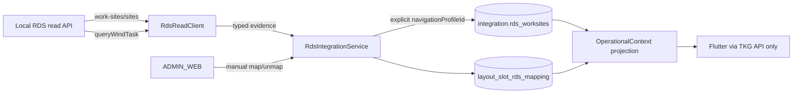

# TKG PDA — Phase 08A Live RDS Readiness

**Kapsam:** canlı RDS bağlantısı, salt okunur WorkSite/Task sorgusu, TKG PostgreSQL aynası ve açık admin slot eşlemesi

**Güvenlik sınırı:** RDS'e yalnız discovery/read/query; bütün yazmalar yalnız TKG PostgreSQL'e

## 1. Canlı ortam kanıtı

Yerel Windows geliştirme makinesinde geniş ağ taraması yapılmadan listener/process korelasyonu gerçekleştirildi. `C:\RDS\data\jdk-11\bin\java.exe` işlemi TCP 8080/8090 portlarını dinliyor; `rdscore\rbk.exe` ve ilişkili RDS işlemleri çalışıyor. Doğrulanan API base URL'i:

```text
http://127.0.0.1:8080
```

- Protokol: HTTP
- Web root: HTTP 200, `text/html`, başlık `rds`
- API: HTTP 200, `application/json`, `code/msg/data` business envelope
- Gözlenen authentication: iki read endpoint'i Authorization header, cookie veya session olmadan cevapladı. Bu gözlem write endpoint'leri için bir authentication iddiası değildir.
- Güvenle keşfedilen sürüm kanıtı: `C:\RDS\data\rdscore\rbk.exe` file/product version `3.4.1.0`. Bu değer yerel RDS core executable kanıtıdır; tüm ürün paketinin pazarlama sürümü olarak genellenmez.

Makineye özel URL tracked configuration'a yazılmadı. Repository default'u `Rds:Enabled=false`, boş `BaseUrl` ve 5 saniye timeout'tur. Canlı yerel çalışma yalnız environment variable ile etkinleştirilir.

## 2. Kanıtlanan read endpoint'leri

### `POST /api/work-sites/sites`

Body `{}` ile canlı sonuç:

| Kanıt | Adet |
|---|---:|
| WorkSite | 22 |
| Physical (`type=1`) | 22 |
| Logical (`type=0`) | 0 |
| Filled (`filled=1`) | 3 |
| Unfilled (`filled=0`) | 19 |
| Locked | 0 |
| Disabled | 0 |
| syncFailed | 0 |
| Non-empty content | 0 |

Gözlenen alanlar `id`, `siteId`, `siteName`, `locked`, `lockedBy`, `filled`, `disabled`, `syncFailed`, `content`, `area`, `rowNum`, `colNum`, `level`, `depth`, `no`, `agvId`, `tags`, `type`, `groupName` ve `holder` içerir. Ayna, şemada ayrı kolonu olan kanıtları kolona; tüm exact item'ı ayrıca `raw_state_json` alanına yazar.

### `POST /api/queryWindTask`

`currentPage=1`, `pageSize=5`, boş `queryParam` ile HTTP/business 200 `Success` alındı. `totalCount=0`, `pageList=null`; mevcut task yoktur. Boş başarılı sonuç geçerli parsing kanıtı kabul edildi ve test için görev oluşturulmadı.

Client `taskRecordId`, `taskLabel`, `status` ve `agvId` filtrelerini destekler. Phase 08A'da bu sorgu için public/admin dispatch yüzeyi açılmaz.

## 3. Mimari



`IRdsReadClient` application portu iki read metoduyla sınırlıdır. `RdsReadClient` tek yerde base address, timeout, `language: en`, correlation, serialization ve response validation uygular. Her cevap için hem HTTP status hem `body.code` hem `body.msg` kontrol edilir. HTTP 200 içindeki non-200 business code, endpoint/business code/correlation taşıyan `RdsReadException` üretir.

Client sonsuz retry yapmaz, `CancellationToken` taşır, cookie kullanmaz ve redirect izlemez. Sync service aynı process içinde `SemaphoreSlim` ile overlapping sync'i reddeder. RDS read tamamen başarılı olmadan TKG transaction'ı açılmaz; transient hata son aynayı silmez ve status `unavailable/stale` döner.

## 4. Navigation profile ve WorkSite aynası

Admin, **RDS'te o anda yüklü sahneyi temsil eden** TKG navigation profile'ını açıkça seçmek zorundadır. Sistem bunu WorkSite adı, slot kodu, variant, makine veya map adından çıkarmaz. Seçilen profile göre şu alanlar upsert edilir:

- `rds_site_id`, `area`, `group_name`, `rds_type`
- `last_filled`, `last_locked`, `last_disabled`, `last_content`
- `last_agv_id`, `last_sync_failed`, `last_sync_at`
- exact item JSON olarak `raw_state_json`

Re-sync `(navigation_profile_id, rds_site_id)` kimliğiyle update yapar; duplicate üretmez. Okuma hatasında absent/stale kayıtlar silinmez. Phase 08A, nullable navigation profile kararını değiştirmez ve migration eklemez; bu akış her zaman non-null açık profil kullanır.

Canlı 22 WorkSite, gerçek `RdsReadClient` üzerinden fresh PostgreSQL 18.3'e yazıldı: ilk sync `22 created / 0 updated`, ikinci sync `0 created / 22 updated`; 22 exact raw JSON kanıtı korundu.

Frozen customer seed'inde henüz gerçek `master.navigation_profiles` kaydı yoktur. Canlı kabul testi bu nedenle yalnız geçici fresh cluster'da, açıkça oluşturulmuş ve test sonunda silinmiş bir navigation profile kullandı. Geliştirme/production DB'sine profil, WorkSite veya slot mapping'i uydurulmadı. Gerçek profile adı/scene ilişkisi müşteri kanıtıyla sağlanana kadar Admin Web senkronizasyon seçeneği bilinçli olarak boş kalabilir; navigation profile yönetimi/map switching Phase 09 sınırıdır.

## 5. Açık slot eşlemesi ve audit

İsimler aynı görünse bile otomatik persistence yasaktır. Admin API ve Layout Editor yalnız insan seçimiyle `integration.layout_slot_rds_mapping` kaydı oluşturur/değiştirir/kaldırır.

Validation:

- slot ve layout mevcut olmalı;
- mirrored WorkSite mevcut olmalı;
- WorkSite `type=1` physical olmalı;
- slot `slot_role=MACHINE` olmamalı;
- navigation profile ile layout aynı machine scope'unda olmalı.

Disabled, locked veya syncFailed physical WorkSite kimliği biliniyorsa eşlenebilir; bu dış durumlar değiştirilmez ve readiness false kalır. Her set/remove transaction'ı `LAYOUT_SLOT_RDS_MAPPING` entity'siyle actor, slot, önce/sonra WorkSite UUID + RDS `siteId`, IP/user-agent ve correlation ID içeren audit yazar. Secret yoktur.

ADMIN_WEB-only endpoint'ler:

| Method | Route | Davranış |
|---|---|---|
| GET | `/api/v1/admin/rds/status` | güvenli endpoint/read durumu |
| GET | `/api/v1/admin/rds/navigation-profiles` | açık seçim seçenekleri |
| POST | `/api/v1/admin/rds/worksites/sync` | RDS read → TKG mirror |
| GET | `/api/v1/admin/rds/worksites` | profile + alan/durum filtreleri |
| GET | `/api/v1/admin/rds/slot-mappings` | layout slot mapping durumu |
| PUT | `/api/v1/admin/layout-slots/{slotId}/rds-mapping` | explicit physical mapping |
| DELETE | aynı route | explicit unmapping |

## 6. Admin Web ve PDA readiness

Admin Web'e RDS Connection, WorkSite Synchronization, WorkSite Browser ve mapping coverage ekranı eklendi. Değerler “dış sistem kanıtı” olarak etiketlenir. Layout Editor inspector'ı logistics slot için profil ve physical WorkSite seçimi sunar; `MACHINE` için “Makine alanı — RDS taşıma noktası eşlenemez” gösterir. Mapping, normalize geometry lifecycle'ından ayrıdır ve RDS'e yazmaz.

OperationalContext'te business `availableActions` semantiği değiştirilmedi. Ayrı `executionReadiness.isExecutionReady` alanı şu kanıtı verir:

| Durum | Sonuç |
|---|---|
| unmapped | false / `RDS_WORKSITE_NOT_MAPPED` |
| mapped logical | false / `RDS_WORKSITE_NOT_PHYSICAL` |
| mapped without successful sync timestamp | false / `RDS_WORKSITE_STALE` |
| mapped disabled | false / `RDS_WORKSITE_DISABLED` |
| mapped syncFailed | false / `RDS_WORKSITE_SYNC_FAILED` |
| mapped locked | false / `RDS_WORKSITE_LOCKED` |
| mapped physical + enabled + synced + unlocked | true |

Flutter yalnız bu TKG API projection'ını okur; RDS base URL, credential veya direct client içermez.

## 7. Test kanıtı

- Canlı RDS salt-okunur harness: **12/12 PASS**; 22 WorkSite, 0 task, çağrılan endpoint'ler yalnız iki read endpoint'i.
- Canlı RDS → fresh PostgreSQL 18.3: **1/1 PASS**; 22/22 idempotent re-sync ve raw JSON.
- Phase 08A fixture PostgreSQL: **1/1 infrastructure + 4/4 ADMIN_WEB API PASS**.
- RDS client unit: **4/4 PASS**; exact evidence, business-code failure, empty task page, disabled/no-call.
- Application readiness: **35/35 PASS** (disabled/syncFailed/locked regression dahil).
- Admin Web: RDS ekranı ve MACHINE mapping guard component testleri dahil.

Tam regresyon sonucu:

| Suite | Sonuç |
|---|---:|
| .NET Release build / format verify | PASS, 0 warning / 0 error |
| Domain | 34/34 |
| Application | 35/35 |
| Auth | 14/14 |
| Phase 03 PostgreSQL script | 21/21 (20 frozen workflow + 1 yeni RDS store acceptance) |
| Phase 04 PostgreSQL/API | 19/19 |
| Phase 05 PostgreSQL/Admin API | 20/20 |
| Phase 07A PostgreSQL/PDA-RDS projection | 4/4 |
| Phase 07B real API contract | 20/20 |
| Phase 08A client unit | 4/4 |
| Phase 08A PostgreSQL/Admin API | 1/1 + 4/4 |
| Admin Web typecheck/lint/unit/build | PASS / PASS / 26/26 / PASS |
| Flutter format/analyze/test | PASS / no issues / 40/40 |
| Phase 02A pipeline/PostgreSQL | 10/10 / PASS |
| Phase 02B pipeline/PostgreSQL | 13/13 / PASS |

Canlı harness'ler opt-in'dir:

```powershell
$env:Rds__Enabled = 'true'
$env:Rds__BaseUrl = 'http://127.0.0.1:8080'
pwsh tests/phase_08a/run_live_rds_readonly.ps1
pwsh tests/phase_08a/run_live_rds_postgres_sync.ps1
```

Normal test suite RDS kurulumu gerektirmez; live test attribute configuration yoksa skip olur.

## 8. Güvenlik ve bilinçli sınırlar

Phase 08A sonucunda:

- **NO ROBOT MOVEMENT**
- **NO WIND TASK CREATION**
- **NO RDS MUTATION**
- `/api/stop-task` çağrısı yok
- `taskDone/taskFailed/taskStopped/workSiteChanged` callback kaydı yok
- WorkSite filled/content/lock/dispatchability/map değişikliği yok
- Flutter direct-RDS bağlantısı yok

Task dispatch, stop/cancel reconciliation, callback güvenliği ve execution mutation Phase 08B'de ayrıca tasarlanacaktır. SEER map/route/profile switching, PLC ve SAP başlamamıştır.
