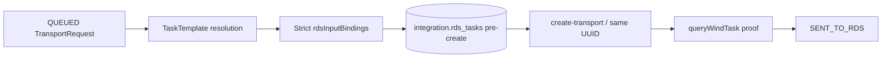
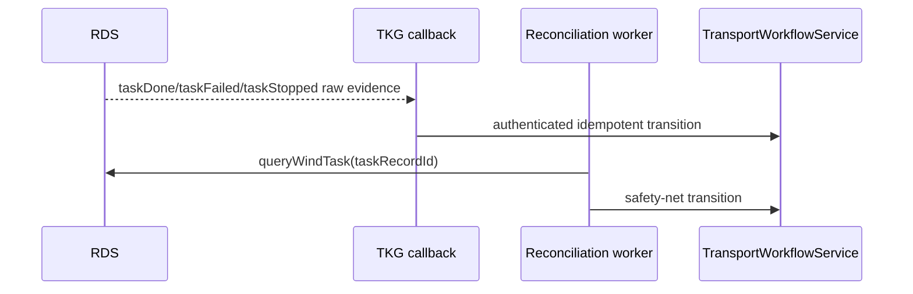

# TKG PDA — Phase 08B RDS Execution Integration

**Kapsam:** güvenli RDS script sınırı, server-side dispatch/reconciliation, callback, doğrulanmış iptal ve PLC'siz yük durumu bildirimi

**DB migration:** Yok. `001_initial_schema.sql`, `002a_customer_textual_master_data.sql` ve `002b_customer_physical_layouts.sql` değiştirilmedi.

## 1. Durum özeti

### IMPLEMENTED

- `taskRecordId = ops.transport_requests.id` değişmez kimliğiyle iki katmanlı idempotency.
- `master.task_templates.config_json.rdsInputBindings` için whitelist tabanlı input binder; expression/eval/reflection yok.
- PostgreSQL request advisory lease kullanan, çakışmayan ve bounded server-side dispatch/reconciliation worker.
- Network çağrısından önce tekil `integration.rds_tasks` kaydı; create cevabı değil `/api/queryWindTask` kanıtı sonrasında `SENT_TO_RDS`.
- `1000/1002/1003/1001/1004/1005/1006` reconciliation ve callback mapping'i.
- Terminal query kanıtı sonrasında ilgili navigation profile'ın WorkSite aynasını tazeleyen, hata halinde iş sonucunu geri almadan retry-safe audit bırakan reconciliation.
- `X-TKG-RDS-Key` ile sabit-zamanlı karşılaştırılan server-to-server callback.
- `/api/stop-task` gönderimi sonrası query/callback kanıtı gelmeden `CANCELLED` saymayan iptal akışı.
- Ayrı `PUT .../load-state` application/domain operasyonu ve Flutter `Kasa Doldu` / `Kasa Boş` akışı.
- Konfigüre edilmediyse RDS `content` anlamı uydurmayan, konfigüre ise yalnız `content` değiştiren helper; `filled` değişmez.
- Admin Web task-template label/binding görünümü ve TKG backend üzerinden RDS validation aksiyonu.
- Version-controlled RDS script artifact'i ve mock `jj` Node test harness'i.

### LIVE VALIDATED

- Yerel RDS Core erişimi: `http://127.0.0.1:8080`, rbk file version `3.4.1.0`; UI kanıtı `RDS F-1.11.4 B-1.8.78`.
- RDS Script Methods imzaları ve Script arayüzü authenticated web oturumunda incelendi.
- Wind Task ekranının boş olduğu doğrulandı: gerçek task definition/label/input variable bulunmuyor.
- RDS scene'de robot group `g2`, simulator robotlar `sim_01` ve `sim_02`; ikisi de `Simulation`. Fiziksel robot bağlı değil.
- Phase 08A read kanıtı korunuyor: 22 physical WorkSite, disabled/locked/syncFailed 0, mevcut Wind Task instance 0.
- Version-controlled artifact RDS Web `boot.js` içine kuruldu, kaydedildi ve Script Start ile yeniden yüklendi.
- `/script-api/tkg/validate-transport` geçersiz anahtarı `401 UNAUTHORIZED` ile ve secret echo etmeden reddetti.
- Doğru anahtar + random `183f1b90-5878-49b4-9b75-de936ea4b636` identity + sentinel label çağrısı HTTP 200 / `TASK_LABEL_NOT_FOUND` döndürdü: `taskLabelExists=false`, `taskRecordExists=false`, `validated=false`.
- Aynı identity için `/api/queryWindTask` sonucu `totalCount=0`; validation hiçbir Wind Task oluşturmadı.

### NOT YET LIVE VALIDATED

- Gerçek Wind Task definition bulunmadığı için label/input binding, create, callback ve stop canlı yürütülmedi.
- RDS scriptindeki development key'ler repoya yazılmadı; bu onay turu RDS tarafı kurulumuyla sınırlı olduğundan aynı değerler TKG API user-secrets/environment alanına kalıcı olarak konfigüre edilmedi. Bu nedenle backend-through validation ve canlı callback ayrıca bekliyor.
- Controlled simulator TransportRequest oluşturulmadı. Güvenlik kapıları gerçek task label/input/route olmadan açılamaz.
- RDS `content` canlı değiştirilmedi; açık test WorkSite ve exact EMPTY/FULL değerleri sağlanmadı.

Canlı dispatch sonucu: `RDS_WIND_TASK_DEFINITION_REQUIRED`. Simulator bulunması bu zorunlu task-definition kapısını ortadan kaldırmaz.

## 2. Canlı RDS Script Methods kanıtı

Kurulu dokümantasyonda doğrulanan imzalar:

- `createWindTask(param: string): void`; `inputParams` task JSON'u içinde ayrıca JSON string olmalıdır.
- `isTaskRecordIdExist(taskRecordId: string): boolean`
- `isTaskLabelExist(taskName: string): boolean`
- `getTaskRecordById(taskRecordId: string): string`
- `updateSitesByCondition(conditions: string, values: string): number`
- `requestHttpPost(url: string, param: string, headParam: string, mediaType: string): string`
- `registerHandler(method: string, path: string, callback: string, auth: boolean): void`
- `registerTaskEventFunction(functionName: string): void`

Script artifact'i bu exact string/global-callback sözleşmesine uyar; `syncCreateWindTask` kullanmaz. Canlı tutorial kanıtı nedeniyle HTTP handler'lar statik top-level fonksiyonlardır ve RDS'in zorunlu `{ code, body }` response zarfını döndürür. Handler request-time'da boot closure state'ine güvenmez; global `jj` köprüsü ve explicit `TKG_RDS_INTEGRATION_CONFIG` kullanır.

## 3. Kimlik, template ve input binding



Template seçimi `variant + product group (exact, sonra NULL fallback) + task type` bağlamındadır. `rds_task_label` hard-code edilmez. Desteklenen kaynaklar:

`SOURCE_RDS_SITE_ID`, `DESTINATION_RDS_SITE_ID`, `SOURCE_SLOT_GROUP_CODE`, `DESTINATION_SLOT_GROUP_CODE`, `MACHINE_CODE`, `VARIANT_CODE`, `PRODUCT_GROUP_CODE`, `PART_CODE`, `CONTAINER_CODE`, `REQUEST_ID`, `REQUEST_NO`, `TASK_TYPE`, `LITERAL`.

Gerekli değer çözülemiyorsa `RDS_TASK_INPUT_UNRESOLVED`; template/binding/label yoksa request `QUEUED` kalır. `MACHINE` region hiçbir binding biçimiyle dispatch'e ulaşamaz. WorkSite isteyen binding için explicit mapping, physical type, enabled, `syncFailed=false`, unlocked ve fresh evidence zorunludur.

## 4. Dispatch ve belirsiz create

Worker yalnız `Rds.Enabled=true` ve `Rds.DispatchEnabled=true` iken çalışır. Aynı request için PostgreSQL advisory lease overlapping worker/callback işini sınırlar. Bir request'in readiness hatası diğer kuyruk kayıtlarını veya reconciliation turunu durdurmaz.

Network öncesi `integration.rds_tasks` satırında:

- `transport_request_id = TKG UUID`
- `rds_task_record_id = TKG UUID string`
- explicit label ve exact request payload

kalıcılaştırılır. HTTP kaybolursa yeni UUID üretilmez; aynı `taskRecordId` query edilir ve aynı identity ile retry edilir. RDS script `isTaskRecordIdExist` ile duplicate create'i engeller. `SENT_TO_RDS`, yalnız query sonucunda exact identity bir kez görüldüğünde application workflow boundary üzerinden yazılır.

## 5. Reconciliation, callback ve iptal



Mapping:

| RDS | TKG davranışı |
|---:|---|
| 1000 | `SENT_TO_RDS → RUNNING` |
| 1002 | nonterminal `WAITING` projection; business status korunur |
| 1003 | kontrollü `RUNNING → COMPLETED` |
| 1001 | cancellation intent varsa `CANCELLED`, aksi halde `FAILED` |
| 1004/1005/1006 | `FAILED`, ended reason korunur |

Callback unknown task identity'yi güvenle ignore eder; duplicate callback terminal durumu yeniden değiştirmez. Callback uzun RDS read çağrısı beklemez; polling safety net kalır.

Polling reconciliation `1001/1003/1004/1005/1006` terminal kanıtını uyguladıktan sonra request'in açık `navigation_profile_id` bağlamındaki WorkSite aynasını yeniden okur. Callback terminal durumu önce uygularsa `rds_tasks + audit` kanıtından türetilen kalıcı pending-refresh sorgusu aynı işi bir sonraki worker turuna taşır; süreç içi/fire-and-forget callback işi kullanılmaz. Bu okuma yürütme sonucunu geri almaz: RDS erişilemiyorsa mevcut business/terminal kanıt korunur ve `RDS_WORKSITE_REFRESH_DEFERRED` audit'i ile sonraki tura bırakılır. Yenilenen `filled/content` alanları fiziksel kanıttır; bu adım slot runtime durumunu doğrudan SQL ile ezmez veya bilinmeyen `content` değerinden EMPTY/FULL tahmin etmez. Callback endpoint'i hızlı kalması için bu ağırlıklı read'i beklemez.

Pre-dispatch iptal lokaldir. `SENT_TO_RDS/RUNNING` için `/api/stop-task` body tam olarak `releaseSite=1` ve UUID `taskRecordId` taşır. Stop HTTP cevabı tek başına fiziksel sonuç değildir; query `1001` veya authenticated `taskStopped` kanıtı gerekir. HTTP response belirsizse cancellation intent kalıcıdır ve API `rdsCancellationPending=true` döner.

## 6. PLC'siz yük durumu

`MARK_FULL` ve `MARK_EMPTY`, transport `TaskType` değildir. Backend tarafından ayrı `loadStateActions` listesinde yayımlanır.

Kurallar: device-bound token, line/supervisor/admin rolü, machine operate permission, aktif layout içindeki enabled non-MACHINE slot, `OCCUPIED`, aktif transport yok ve hedef yalnız `EMPTY/FULL`. Endpoint occupancy/part/container alanlarını değiştirmez. Warehouse rolünün UI bypass ile bu endpoint'i çağırması da 403 ile engellenir.

Normal akış:

```text
BRING_EMPTY tamamlandı → OCCUPIED + EMPTY
operatör Kasa Doldu → OCCUPIED + FULL
context refetch → REMOVE_FULL mevcut workflow kuralıyla açılır
```

RDS content değerleri tracked config'de boştur. Exact değerler verilmedikçe TKG update başarılı olabilir fakat sync sonucu `NOT_CONFIGURED` olur. Helper yalnız `updateSitesByCondition({siteIds}, {content})` kullanır; `filled` göndermez.

## 7. Konfigürasyon ve güvenlik

Tracked defaultlar `Enabled=false`, `DispatchEnabled=false`; secret yoktur. Live değerler environment/user-secrets ile sağlanır:

```text
Rds__Enabled
Rds__BaseUrl
Rds__DispatchEnabled
Rds__IntegrationKey
Rds__CallbackUrl
Rds__CallbackKey
Rds__EmptyContentValue
Rds__FullContentValue
```

Integration/callback key 32–512 karakter olmalıdır. HTTP non-loopback dispatch default olarak reddedilir. Production, HTTPS reverse proxy veya güçlü ağ izolasyonu gerektirir. Request body/key loglanmaz; audit yalnız güvenli action/code/message/correlation taşır.

## 8. RDS Script kurulumu

Artifact: `rds/scripts/tkg_integration.js`. Yalnız RDS Web → Script arayüzü kullanılır; RDS iç dosyası veya DB'si değiştirilmez.

`boot.js` içinde artifact ile birlikte placeholder'ları secret store değerleriyle dolduran şu boot çağrısı kullanılır:

```js
var TKG_RDS_INTEGRATION_CONFIG = {
  integrationKey: "<environment secret>",
  callbackUrl: "http://127.0.0.1:<TKG_PORT>/api/integrations/rds/events",
  callbackKey: "<environment secret>"
};

function boot() {
  TkgRdsIntegration.install(jj, TKG_RDS_INTEGRATION_CONFIG);
}
```

İlk canlı çağrı yalnız `/script-api/tkg/validate-transport` olmalıdır. Kurulu scene'de label bulunmadığı için non-motion sonuç `TASK_LABEL_NOT_FOUND`, `taskRecordExists=false` ve RDS task count 0 olarak kanıtlandı. Gerçek label sağlandığında `validated=true` alınmadan create açılmaz.

## 9. Test kanıtı

| Suite | Sonuç |
|---|---:|
| .NET Release build | PASS, 0 warning / 0 error |
| Domain | 34/34 |
| Application | 58/58 |
| Auth | 14/14 |
| Phase 08B fresh PostgreSQL infrastructure | 25/25 |
| Phase 08B fresh PostgreSQL API | 58/58 + 1 opt-in live skip |
| RDS script Node harness | 14/14 |
| Admin Web typecheck/lint/unit/build | PASS / PASS / 27/27 / PASS |
| Flutter format/analyze/test/debug APK | PASS / no issues / 42/42 / PASS |
| Phase 02A pipeline/PostgreSQL | 10/10 / PASS |
| Phase 02B pipeline/PostgreSQL | 13/13 / PASS |
| Phase 03/04/05/07A/07B/08A regressions | PASS |

PostgreSQL 18.3 verification: 9 machine masters, 11 display-only MACHINE regions, 0 orphan `rds_tasks`, 0 duplicate non-null `rds_task_record_id`.

## 10. Controlled simulator gate

| Önkoşul | Sonuç |
|---|---|
| Simulator robot | PASS — `sim_01`, `sim_02` |
| Physical robot absent | PASS |
| Custom script installed/validated | PARTIAL PASS — installed; auth/parse/identity non-motion validation passed, real label absent |
| Actual Wind Task definition | **FAIL — none exists** |
| Exact task input names | BLOCKED by missing definition |
| Explicit task template | BLOCKED by missing definition |
| Source/destination physical WorkSites | 22 candidates exist, pair not selected/configured |
| Duplicate active task | PASS — observed 0 |

Bu nedenle controlled Wind Task yürütülmedi. Hazırlanabilecek exact create payload ancak müşteri/RDS mühendisi task label, input variables ve anlamlarını tanımladıktan sonra oluşabilir; tutorial label veya parametre uydurulmaz. PLC, SAP, SEER route/map/profile çalışması yapılmadı.
