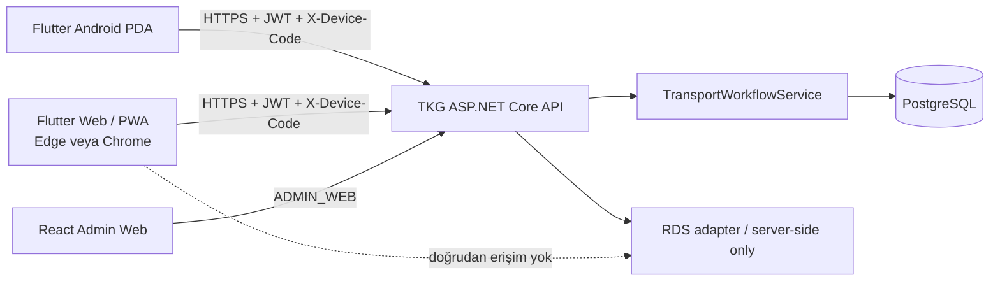

# TKG PDA — Phase 09 Multi-Platform Operator Client

**Kapsam:** Android endüstriyel PDA + Windows hat terminali Flutter Web/PWA

**DB migration:** Yok

**Native Windows istemcisi:** Yok

## Sonuç ve donmuş ürün şartı

TKG Operator Client artık Android'e özel değildir. Aşağıdaki şart üretim baseline'ıdır:

> TKG Operator Client must support both Android industrial PDAs and Windows-based production-line touch terminals through Web/PWA. Both platforms use the same Flutter codebase, TKG API contracts, device-bound security model, and server-authoritative workflow rules.

Windows üretim istemcisi Edge/Chrome içinde çalışan Flutter Web/PWA'dır. Native Windows `.exe`, ikinci React operator uygulaması, Web'e özel workflow veya istemci tarafında kopyalanmış iş kuralı oluşturulmadı. React Admin Web ayrı `ADMIN_WEB` uygulaması olarak kalır.

Phase 08C PR #9 merge edilmiş, yeni `main` baseline'ı `b05b53ead1bce037d9e7f25de41c15549bf1cab6` olmuştur. Phase 09 mevcut şemayı migration değiştirmeden genişletir.

## Mimari



`src/TkgPda.Pda` tek composition root ve tek feature setidir. Platform farkları `core/platform`, runtime config ve `DeviceCodeStore` implementasyonlarında tutulur. `availableActions`, makine yetkileri, variant capability, load-state eylemleri ve transport doğrulaması aynı backend sözleşmesinden gelir.

## Platform ve güvenlik sınırları

| Veri | Android | Web/PWA | Kalıcılık |
|---|---|---|---|
| Device Code | `flutter_secure_storage` | origin-scoped `localStorage` | Evet |
| JWT | `SessionMemory` | tab/process `SessionMemory` | Hayır |
| Parola | Login controller/call argümanı | Login controller/call argümanı | Hayır |
| User/permission/context | Bellek | Bellek | Hayır |
| Idempotency/command | Bellek | Bellek | Hayır |

Web'in yazdığı tek persistent uygulama anahtarı `tkg.pda.device-code` değeridir. JWT; `localStorage`, `sessionStorage`, IndexedDB, cookie, Cache Storage, URL, history veya service worker verisine yazılmaz. Yenileme ve browser/PWA restart sonrasında Device Code kalır, JWT kaybolur ve login gerekir. Her tab kendi memory session'ını taşır.

Device Code değiştirme akışı bilinçli onay ister. Onaydan sonra session, user, machine/context, seçimler ve idempotency belleği temizlenir; yeni kod yazılır ve uygulama login'e döner. Flutter backend'de cihaz kaydı oluşturmaz.

Merkezi `ApiClient`, login dahil device-bound çağrılara `X-Device-Code`, authenticated çağrılara memory-only Bearer JWT ve maddi komutlara `Idempotency-Key` ekler. 401 callback'i oturumu ve operasyonel cache'i temizler, Device Code'u korur ve login'e döndürür.

## API adresi ve CORS

API adresi şu öncelikle çözülür:

1. `--dart-define=TKG_API_BASE_URL=...`
2. Web'de `operator-config.json` içindeki non-secret `apiBaseUrl`
3. Web'de mevcut sayfanın same-origin origin'i
4. Android geliştirmede emulator default'u `http://10.0.2.2:5000`

Yalnız user-info/query/fragment içermeyen HTTP(S) URI kabul edilir. Üretim IP'si, müşteri URL'si veya RDS adresi Flutter source'a yazılmaz. Önerilen yayın aynı origin'dir:

```text
https://tkg.example/operator/
https://tkg.example/api/...
```

Ayrı Web/API origin'i gerektiğinde ASP.NET Core `Cors:AllowedOrigins` exact-origin listesi kullanılır. Wildcard reddedilir; credentials/cookie açılmaz. İzinli metodlar `GET`, `POST`, `PUT`, `OPTIONS`; header'lar `Accept`, `Authorization`, `Content-Type`, `X-Device-Code`, `Idempotency-Key`, `X-Correlation-ID`; exposed response header yalnız `X-Correlation-ID` değeridir. Konfigüre edilmemiş origin preflight kabul edilmez.

## Web/PWA ve izole LAN

Üretim build'i:

```powershell
flutter build web --release --no-web-resources-cdn --base-href /operator/
```

Flutter 3.44.8'de doğrulanan `--no-web-resources-cdn`, CanvasKit/WASM'ı yerel build'e alır. Engine'in varsayılan `fonts.gstatic.com` fallback davranışı `fontFallbackBaseUrl: 'font-fallbacks/'` ile yerel uygulama varlıklarına yönlendirilmiştir. Kullanılan Roboto ve Noto Sans Symbols WOFF2 dosyaları uygulamayla yayınlanır. Gerçek browser asset envanterinde public origin ve RDS endpoint isteği sıfırdır.

Manifest adı/short name'i `TKG Operator`, display modu `standalone`, start/scope/id uygulamanın göreli `/operator/` kapsamıdır. İkonlar yereldir. Local HTTP kabulünde manifest, 192/512 ikonlar ve service worker başarıyla istendi; production'da HTTPS önerilir.

Özel service worker yalnız public statik app shell ve statik varlıkları cache'ler. Aşağıdakileri cache/queue/replay etmez:

- GET dışındaki istekler;
- `/api/` trafiği;
- `Authorization`, `X-Device-Code` veya `Idempotency-Key` taşıyan istekler;
- transport, variant veya load-state komutları.

Background Sync, IndexedDB command queue veya offline mutation replay yoktur. Offline app shell açılabilse bile mutation kapalı kalır.

## Windows touch yerleşimi

`OperationScreen`, 1000 logical pixel ve üstünde responsive split view kullanır:

- sol: makine, variant, Parça/Alt Parça ve aktif talepler;
- sağ: normalize layout, slot seçimi, readiness/durum ve action paneli;
- dar görünüm: aynı shared widget'ların kompakt tek kolon akışı.

1024×600, 1280×720, 1366×768 ve 1920×1080 boyutları overflow olmadan widget test edilmiştir. Primary action'lar yaklaşık 48 logical pixel minimum touch target kullanır; kritik eylemler icon-only değildir. Transport, cancel, variant ve load-state mutation'ları onay ister. Hover gereksinimi yoktur.

`slot_role = MACHINE` bölgeleri yalnız fiziksel/ekran referansıdır; seçilemez ve transport eylemi taşımaz. Normalize 0–1 geometri Web'de de UI görselleştirmesidir; robot haritası, milimetre veya RDS koordinatı değildir.

## Lifecycle, polling ve offline

Visible/foreground uygulama mevcut tek polling algoritmasını kullanır. Hidden/paused durumda polling durur ve mutation guard kapanır. Resume'da `/auth/me`, ardından machine/context refetch tamamlanmadan mutation yeniden açılmaz. Çakışan context isteği `_contextLoading` guard'ıyla engellenir.

Bağlantı kaybında son memory görünümü stale uyarısıyla kalabilir; transport, variant ve load-state mutation'ları kapalıdır. Persistent command queue yoktur. Belirsiz sonuç yalnız aynı in-memory idempotency key ile açık operatör retry'ına izin verir; refresh/restart eski komutu kendiliğinden yeniden göndermez.

## Browser kabul kapsamı

Fresh PostgreSQL 18.3 + `001 + 002a + 002b`, gerçek Release ASP.NET Core API ve gerçek Flutter Web browser test harness'i `tests/phase_09/run_web_operator_e2e.ps1` içindedir. Her koşu random runtime parola/JWT key'i üretir, `Rds.Enabled=false` kullanır ve kapanışta DB, API, WebDriver ve geçici dosyaları temizler.

Chrome 151 ve gerçek Edge 151 üzerinde aynı test çalışır. Flutter 3.44'ün eski Edge W3C capability adı, yalnız test sırasında yerel proxy ile `MicrosoftEdge/ms:edgeOptions` biçimine çevrilir; uygulama/runtime davranışı değişmez.

Kapsam:

- ilk Device Setup, persistent Device Code ve login;
- gerçek backend machine permission ile yalnız `SH-01-A` görünmesi;
- variant capability ve gerçek switch/restore;
- Parça/Alt Parça, layout, MACHINE ve logistics slot;
- backend `availableActions`, `REMOVE_FULL`, `REMOVE_EMPTY`, `MARK_FULL`, `MARK_EMPTY` projeksiyonu;
- onaylı `BRING_EMPTY`, aktif talep ve onaylı cancellation;
- pause/resume server revalidation;
- 401 temizliği;
- reload/restart: Device Code kalır, JWT/login kalmaz;
- persistent storage key izolasyonu ve password/JWT yokluğu.

Offline, 401, idempotency, 1024/1366/1920 responsive davranışı ayrıca shared widget/unit testlerinde çalışır. Web kaynak sözleşmesi `tests/phase_09/web_contract.test.mjs`; PWA manifest, yerel fontlar, static-only service worker ve RDS endpoint yokluğunu doğrular.

### Kabul sonuçları

| Kapı | Sonuç |
|---|---|
| Flutter formatter / analyzer | 40 dosyada fark yok / 0 issue |
| Flutter unit + widget | 51/51 PASS |
| Android debug APK | PASS |
| Production Web `/operator/` build | PASS |
| Chrome real API/browser | 47 frozen check, PASS |
| Edge real API/browser | 47 frozen check, PASS |
| Fresh PostgreSQL | 18.3, 9 machine, 2 cancelled test request, 0 orphan |
| PWA/static contract | 4/4 PASS |
| Production browser asset audit | 11 local asset, 0 public origin, 0 RDS endpoint |
| Domain / Application / Auth | 34/34, 58/58, 14/14 PASS |
| Phase 03 / 04 / 05 | 25/25, 19/19, 20/20 PASS |
| Phase 07A / 07B | 4/4, 20/20 PASS |
| Phase 08A | infrastructure 1/1 + API 4/4 PASS |
| Phase 08B | infrastructure 25/25 + API 60 PASS, 1 live-opt-in test skipped |
| RDS script code-level | 14/14 PASS |
| React Admin Web | typecheck/lint, 27/27 unit, 19/19 E2E, production build PASS |

## Faz sınırı

`TKG_SIM_MOVE` development/commissioning-only sabit `AP15 → AP20` görevidir. Export edilen task-level `inputParams` boş olduğu ve gönderilen `fromPoint/toPoint` değerlerini tüketmediği için dinamik Wind Task expression serialization kanıtlanmış değildir. Bu task production `BRING_EMPTY`, `REMOVE_FULL` veya `REMOVE_EMPTY` için yeniden kullanılmaz. Production task commissioning, SEER navigation, PLC ve SAP bu fazda başlamamıştır.

**NO NATIVE WINDOWS CLIENT WAS CREATED.** Windows production client, Edge/Chrome içinde Flutter Web/PWA'dır.
