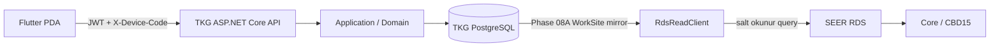
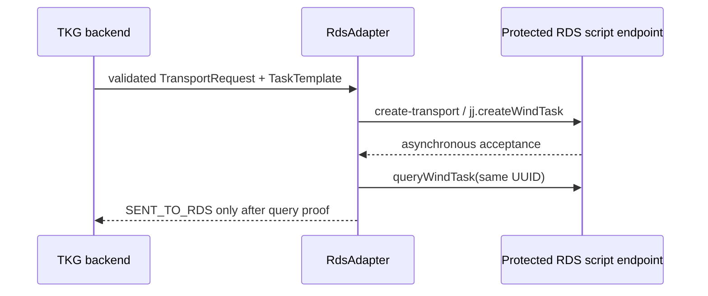

# TKG PDA — RDS/PDA Entegrasyon Sözleşmesi

**Durum:** Phase 08B execution integration implemented; controlled live task blocked by missing RDS Wind Task definition

**Canlı entegrasyon:** WorkSite/Wind Task read kanıtlandı; `sim_01`/`sim_02` mevcut, fiziksel robot yok. RDS script kurulumu ve non-motion validation auth/parse/identity sınırı canlı geçti. Wind Task definition listesi boş olduğundan create/stop/callback canlı yürütülmedi.

**Şema kaynağı:** `db/migrations/001_initial_schema.sql`

Bu belge Flutter PDA ile SEER RDS entegrasyonu arasındaki sorumlulukları sabitler. Phase 08B server-side script/dispatch/reconciliation/callback/cancel ve load-state sınırını uygular; Flutter RDS'e bağlanmaz ve doğrudan RDS mutation göndermez.

## 1. Kaynak gerçekleri ve güven sınırı



- **TKG iş gerçeğinin kaynağıdır:** kullanıcı/rol/makine yetkisi, variant ve layout seçimi, product group/part/container kanıtı, slotun `VACANT/OCCUPIED/UNKNOWN` ve `EMPTY/FULL/UNKNOWN` semantiği, taşıma talebi, idempotency ve audit.
- **RDS yürütme ve filo gerçeğinin kaynağıdır:** WorkSite'ın güncel yürütme durumu, Wind Task durumu, robot ataması, trafik/bekleme ve robot yürütme sonucu.
- Flutter yalnız TKG API ile konuşur. RDS adresi veya credential'ı Flutter'a verilmez; Flutter doğrudan RDS endpoint'i çağırmaz.
- TKG domain kuralları RDS veya istemci tarafından yeniden tanımlanmaz. RDS callback/poll sonucu TKG'nin kontrollü application/integration boundary'sinden geçirilir.

## 2. LayoutSlot ↔ RDS WorkSite

Kalıcı ilişki:

```text
master.layout_slots.id
  ↕ integration.layout_slot_rds_mapping.layout_slot_id
integration.rds_worksites.id
```

RDS `siteId`, TKG slot kodundan türetilmez. Eşleme yoksa `isMapped=false` döner ve bütün WorkSite alanları `NULL` kalır; bu durum müşteri master-data bozukluğu sayılmaz, execution readiness eksikliğidir.

Phase 07A read contract mevcut kalıcı alanları olduğu gibi projekte eder:

| PDA alanı | PostgreSQL kanıtı |
|---|---|
| `siteId` | `rds_site_id` |
| `area` | `area` |
| `groupName` | `group_name` |
| `type` | `rds_type` |
| `filled` | `last_filled` |
| `locked` | `last_locked` |
| `disabled` | `last_disabled` |
| `syncFailed` | `last_sync_failed` |
| `content` | `last_content` |
| `agvId` | `last_agv_id` |
| `lastSyncAt` | `last_sync_at` |

RDS WorkSite sözleşmesinin `filled`, `locked`, `lockedBy`, `disabled`, `syncFailed`, `content`, `type` ve `groupName` alanları Phase 08A'da canlı cevapta doğrulanmıştır. Mevcut TKG şeması `lockedBy` için ayrı kolon içermez; exact canlı payload `raw_state_json` içinde korunur ve projection ayrı alan uydurmaz.

### 2.1 Doluluk ve yük semantiği

| TKG iş durumu | RDS projeksiyonu |
|---|---|
| `VACANT` | `filled = 0` |
| `OCCUPIED` | `filled = 1` |
| `UNKNOWN` | kesin eşleme yapılmaz |

`EMPTY/FULL` TKG'nin iş semantiğidir. Phase 08B yalnız exact `Rds:EmptyContentValue` / `Rds:FullContentValue` sağlandığında RDS WorkSite `content` alanını eşitler; tracked defaultların ikisi de boştur. `EmptyTray`, `FullTray` gibi tutorial string'leri wire contract değildir. Helper hiçbir zaman `filled` değiştirmez; EMPTY ve FULL durumunda da fiziksel nesne WorkSite'ı işgal eder.

`locked` veya aktif TKG talebi slotun meşgul/rezerve olmasını gösterebilir. Bunun için `ops.slot_runtime_state.occupancy_state` alanına `RESERVED` eklenmez. Mevcut izinli değerler yalnız `VACANT`, `OCCUPIED`, `UNKNOWN` olarak kalır.

`slot_role = MACHINE` kayıtları yalnız normalize ekran/fiziksel referanstır; hiçbir RDS taşıma source/destination'ı olamaz.

## 3. Wind Task dispatch stratejisi

Uygulanan Phase 08B dispatch yönü:



- Tek bir global Wind Task label hard-code edilmez. `master.task_templates`, `variant_id + product_group_id + task_type_id` bağlamında `rds_task_label`, source/destination slot group, priority ve `config_json` sağlar.
- Uygun aktif template veya `rds_task_label` yoksa bu gerçek `RdsTaskLabelConfigured=false` olarak görünür; label tahmin edilmez ve Phase 08 dispatch readiness kuralı görevi durdurmalıdır.
- Phase 08B worker template input'larını strict `rdsInputBindings` whitelist'iyle çözer; required değer yoksa dispatch yapmaz.
- Kanonik correlation `ops.transport_requests.id ↔ integration.rds_tasks.rds_task_record_id ↔ RDS taskRecordId` olarak uygulanmıştır.
- `request_no`, uygun RDS projelerinde `outOrderNo` ile ilişkilendirilir. Kanonik UUID correlation'ın yerine tek başına kullanılmaz.
- HTTP 200 iş başarısı anlamına gelmez. `RdsAdapter` response body içindeki `code/msg` alanlarını doğrulamadan dispatch, query, stop veya WorkSite update işlemini başarılı sayamaz.

## 4. Task sorgu, iptal ve reconciliation

Phase 08B execution entegrasyonunda kullanılan RDS operasyonları:

- Task sorgu: `/api/queryWindTask` (Phase 08A client parsing'i salt okunur olarak kanıtlandı)
- Task durdurma: `/api/stop-task`
- Task oluşturma: korumalı özel RDS script endpoint'i üzerinden `jj.createWindTask(...)`

`SENT_TO_RDS` ve `RUNNING` talepler mevcut cancel endpoint'inden backend RDS cancellation boundary'sine gider. `/api/stop-task` body `releaseSite=1` ve aynı UUID `taskRecordId` taşır. HTTP cevabı iptal kanıtı değildir; query `1001` veya authenticated `taskStopped` gelene kadar response `rdsCancellationPending=true` taşır ve TKG fiziksel gerçeği varsayımla değiştirilmez.

Birincil event yolu:

```text
RDS taskDone / taskFailed / taskStopped / workSiteChanged / ilgili event
→ korumalı TKG callback endpoint'i
→ RdsAdapter doğrulaması
→ Application integration boundary
→ PostgreSQL transaction + audit
```

Güvenlik ağı:

```text
TKG reconciliation worker
→ /api/queryWindTask
→ response code/msg + task state doğrulaması
→ idempotent reconciliation
```

Callback `X-TKG-RDS-Key` ile doğrulanır; unknown identity mutation yapmaz, duplicate terminal event zararsızdır. Polling reconciliation zorunlu safety net olarak kalır. Production reverse proxy/network allow-list ve operasyonel dead-letter/alerting dağıtım konfigürasyonudur.

RDS custom HTTP handler'ları tutorial'da doğrulanan statik top-level fonksiyon adlarıyla kaydedilir ve `{ code, body }` zarfı döndürür. Request execution boot closure state'ine güvenmez; global `jj` ve explicit script config'i stateless olarak handler'a verilir.

Terminal polling kanıtından sonra request'in navigation profile'ı için WorkSite aynası tazelenir. Callback terminal durumu polling'den önce uygularsa mevcut `rds_tasks` terminal kanıtı ve başarılı-refresh audit yokluğu, işi sonraki worker turunda kalıcı olarak yeniden seçer. Refresh hatası terminal workflow sonucunu geri almaz; audit edilir ve tekrar denenebilir. RDS `filled/content` fiziksel kanıtı bu adımda slot runtime satırına doğrudan yazılmaz: yalnız workflow completion semantiği occupancy değiştirir, `content` ise ancak konfigüre edilmiş exact EMPTY/FULL değerlerinden biriyle eşleşirse anlam taşır.

## 5. PDA execution projeksiyonu

PDA ham RDS statüsünü tek UI durumu olarak kullanmaz. `ops.transport_requests` ile kalıcı `integration.rds_tasks` kanıtından şu kararlı durumlar üretilir:

| PDA state | Anlam |
|---|---|
| `REQUESTED` | TKG talebi oluşturuldu/doğrulanıyor |
| `QUEUED` | TKG kuyruğunda |
| `WAITING_FOR_ROBOT` | RDS sınırında, atanmış robot/hareket kanıtı yok |
| `ROBOT_ASSIGNED` | kalıcı `agvId` var; fiziksel hareket iddia edilmez |
| `RUNNING` | TKG veya kalıcı RDS başlangıç kanıtı |
| `WAITING` | suspended veya trafik bekleme koşulu |
| `COMPLETED` | başarıyla tamamlandı |
| `FAILED` | abnormal/exception/failure |
| `TERMINATED` | durduruldu/iptal edildi |

Bilinen RDS durumları: `1000 running`, `1001 terminated`, `1002 suspended`, `1003 finished`, `1004 abnormal finish`, `1005 restart exception`, `1006 abnormal interruption`. `1000` tek başına robotun hareket ettiğini kanıtlamaz. Terminal TKG business status, gecikmiş/çelişkili kalıcı RDS statüsüne üstün gelir.

## 6. Hata ve operatör mesajı

PDA sözleşmesi `failureCode`, `failureCategory`, Türkçe/güvenli `operatorMessage`, yetkili teknik görünüm için `technicalMessage` ve `correlationId` taşır.

| RDS/Core örneği | PDA kodu | Kategori | Sonuç |
|---|---|---|---|
| `60008`, `fail_lock_bin` | `WORKSITE_BUSY` | `WORKSITE` | güvenli operatör açıklaması |
| `60009`, `no_path` | `PATH_UNAVAILABLE` | `NAVIGATION` | güvenli operatör açıklaması |
| `60011`, `task_failed` | `EXECUTION_FAILED` | `EXECUTION` | güvenli operatör açıklaması |
| `54002`, `54003` | `TRAFFIC_WAITING` | `TRAFFIC` | `WAITING`; otomatik `FAILED` değildir |

Ham/Çince teknik metin birincil PDA mesajı olamaz. Phase 07A'da teknik ayrıntı yalnız device-bound `ADMIN`/`SUPERVISOR` projeksiyonunda verilir. Tam alarm ingestion, kod kataloğu ve localization Phase 08 kapsamıdır.

## 7. Koordinat ve map sınırı

`master.layout_slots.ui_x/ui_y/ui_width/ui_height` yalnız 0–1 normalize Admin/PDA ekran geometrisidir. Robot, SEER, RDS, harita veya milimetre koordinatı değildir. Phase 07A route, waypoint, stitch, map veya navigation-profile switching üretmez.

Public RDS API düzeyinde map/profile switching henüz kanıtlanmamıştır. Endpoint veya davranış uydurulamaz; `SeerMapAdapter` ayrı gelecek çalışmadır.

## 8. Phase sınırları

Phase 08B'de kesinlikle bulunmaz:

- tracked RDS credential, production IP veya secret;
- Flutter'dan direct RDS bağlantısı;
- task label/input variable tahmini;
- robot/map koordinatı, route/stitch veya SEER navigation-profile switching;
- PLC veya SAP entegrasyonu.

Script/dispatch/callback/cancel otomatik ve fresh PostgreSQL testlerinde kanıtlanmıştır. Canlı RDS'te gerçek Wind Task definition bulunmadığı için custom script installation/validation ve simulator execution henüz canlı kabul kanıtı değildir. Ayrıntı [PHASE_08B_RDS_EXECUTION_INTEGRATION.md](PHASE_08B_RDS_EXECUTION_INTEGRATION.md) belgesindedir.
