# TKG Otomotiv PDA — Database Architecture v0.1

**Status:** Baseline for Phase 1 implementation
**Date:** 2026-08-18
**Primary references:** Customer Excel package, especially `AGV - BAKIM - PLC Çalışma.xlsx`, `AMR Çalışma Planı.xlsx`, and machine-specific variant layout workbooks; `RdsApi_en.md` for RDS public API surface.

## 1. Scope frozen for Phase 1

Phase 1 is operator-driven. There is **no PLC communication** in this phase. The operator logs in, selects a machine and the active production variant, views the variant-specific layout/slots, and manually starts logistics requests. The SEER CBD15 robot remains under RDS for fleet/task execution. The PDA/backend owns business context, user authorization, variant/layout selection, slot/load state, audit history, and request orchestration.

The three initial logistics operations are:

- `BRING_EMPTY` — bring an empty pallet/container to the selected destination.
- `REMOVE_FULL` — remove a full pallet/container from the selected source.
- `REMOVE_EMPTY` — remove an empty pallet/container from the selected source.

Warehouse operators can also initiate empty-container requests. PLC/API-triggered requests are reserved for a later phase but the data model keeps a `request_origin` field so that Phase 2 does not require redesigning the transport-request model.

## 2. Customer naming baseline

The current machine/cell labels are preserved as customer-facing identifiers:

1. `SH-01-A`
2. `SH-01-B`
3. `SH-01-P1--SH-01-P2`
4. `SH-02-P1 -SH-02-P2`
5. `SEALER`
6. `PAH-01-A`
7. `412B`
8. `PAH-02-A`
9. `GAR`

The customer workbooks indicate variant counts of 5, 3, 2, 2, 3, 2, 3, 2, and 3 respectively. These are seeded only as initial configuration; all must remain editable by Admin.

`AGV - BAKIM - PLC Çalışma.xlsx` provides the primary interaction model: a machine contains selectable main part codes; each main part exposes related/alt part codes and container actions such as `1. Kasa Doldu`, `1. Kasa Boş`, additional numbered container buttons where required, and `Tüm Kasaları Kaldır`. In Phase 1 these become software actions instead of PLC signals.

For the SH-01-A Variant 1 source discrepancy, `67115BN050-10-HAOS` is the canonical part code because it appears consistently in the interaction, takt-time and working-plan sources. The single `67115BN050-10-HMTR` occurrence in the layout workbook is retained as a source note/data issue pending customer confirmation; it does not block the baseline.

## 3. Core modeling decision

A variant is not only a list of part codes. A variant may change the physical pallet/container footprint and therefore the usable robot path/profile. The factory's physical base map can remain the same while the active route/stitch profile changes by variant.

Therefore the system separates:

- **Machine** — customer cell/machine.
- **Variant** — operator-selectable production configuration for a machine.
- **Product Group** — a main `Parça` card/selection inside a variant.
- **Related Parts** — `Alt Parça` / related parts associated with that product group.
- **Navigation Profile** — versioned, machine-scoped SEER/RDS map-route-stitch configuration that may be assigned to multiple variants.
- **Variant Navigation Profile Assignment** — maps variants to reusable navigation profiles and identifies the default assignment.
- **Layout** — versioned, machine-scoped PDA/physical slot arrangement that may be shared by multiple variants.
- **Variant Layout Assignment** — maps variants to reusable layouts and identifies the default assignment.
- **Layout Slot** — a logical pallet/container position in a published layout.
- **RDS WorkSite Mapping** — external RDS work-site reference for a layout slot.
- **Runtime State** — currently active variant/layout/profile and current slot states.
- **Transport Request** — the business task created by a user.
- **RDS Task** — the external RDS task instance associated with a transport request.

The application must never use RDS as the source of customer-specific master data. RDS identifiers are integration references.

## 4. Important state separation

A location cannot be represented by only `FULL/EMPTY` because two independent questions exist:

1. Is there a pallet/container physically present at the slot?
2. If present, is that pallet/container empty or full?

The database therefore stores:

- `occupancy_state`: `VACANT | OCCUPIED | UNKNOWN`
- `load_state`: `EMPTY | FULL | UNKNOWN`

A slot may also be temporarily reserved through a transport request. Reservation is modeled by workflow state rather than conflating it with physical occupancy.

For RDS synchronization, RDS `filled=1` corresponds to physical `OCCUPIED`; it does **not** mean the load is full.

## 5. Versioning and Admin behavior

Layouts and navigation profiles are versioned, published machine-scoped definitions. Their version identity is unique by `(machine_id, code, version)`, while a partial unique index permits only one `PUBLISHED` version for a logical `(machine_id, code)` resource. Admin edits create or update draft configuration; a draft is not used by operators until it is published. Assignment tables map variants to these reusable definitions, and a variant has at most one default layout assignment and one default navigation-profile assignment at a time. Multiple variants may point to the same published definition. If a later customer source introduces a distinct layout or navigation profile for a variant, its assignment can be changed without duplicating or renaming the variant.

The assignment tables carry `machine_id` and use composite foreign keys to both sides. This declaratively rejects a layout/profile assignment when the variant and resource belong to different machines; no cross-table trigger is required. Layout and navigation profile remain independent configuration dimensions and have no direct foreign key to one another.

The combined SH-01-P1/P2 and SH-02-P1/P2 source currently establishes two production variants per machine but only one common physical plan. The baseline therefore permits both variants to share that plan and does not invent a second layout or navigation profile.

The machine runtime record holds the active variant, layout, and navigation profile. A variant change must be performed in one database transaction and must be rejected by the service layer if an incompatible active transport task exists.

No customer-facing machine, part, variant, slot, RDS site, or task-template configuration should be hard-coded in PDA UI code.

## 6. Security and audit requirements

Passwords are stored only as secure password hashes by the application layer. Database schema never contains plaintext passwords.

User roles start with:

- `ADMIN`
- `SUPERVISOR`
- `LINE_OPERATOR`
- `WAREHOUSE_OPERATOR`

Machine-level permissions are modeled separately so that a user can be limited to specific machines. Every operational action and every Admin configuration change must be traceable to a user and optional PDA/device.

The generic audit record contains actor, action, entity type/id, before/after JSON values, client IP, device reference, correlation/request ID, and timestamp. Audit rows are append-only at application level.

## 7. ERD

```mermaid
erDiagram
    USERS ||--o{ USER_ROLES : has
    ROLES ||--o{ USER_ROLES : assigned
    USERS ||--o{ USER_MACHINE_PERMISSIONS : scoped
    MACHINES ||--o{ USER_MACHINE_PERMISSIONS : controls

    MACHINES ||--o{ VARIANTS : has
    VARIANTS ||--o{ PRODUCT_GROUPS : contains
    PARTS ||--o{ PRODUCT_GROUPS : main_part
    PRODUCT_GROUPS ||--o{ PRODUCT_GROUP_PARTS : contains
    PARTS ||--o{ PRODUCT_GROUP_PARTS : related_part
    CONTAINER_TYPES ||--o{ PRODUCT_GROUP_PARTS : uses

    MACHINES ||--o{ NAVIGATION_PROFILES : scopes
    VARIANTS ||--o{ VARIANT_NAVIGATION_PROFILE_ASSIGNMENTS : selects
    NAVIGATION_PROFILES ||--o{ VARIANT_NAVIGATION_PROFILE_ASSIGNMENTS : reusable_by
    MACHINES ||--o{ LAYOUTS : scopes
    VARIANTS ||--o{ VARIANT_LAYOUT_ASSIGNMENTS : selects
    LAYOUTS ||--o{ VARIANT_LAYOUT_ASSIGNMENTS : reusable_by
    LAYOUTS ||--o{ LAYOUT_SLOTS : contains
    LAYOUTS ||--o{ SLOT_GROUPS : groups
    SLOT_GROUPS ||--o{ SLOT_GROUP_MEMBERS : contains
    LAYOUT_SLOTS ||--o{ SLOT_GROUP_MEMBERS : member

    NAVIGATION_PROFILES o|--o{ RDS_WORKSITES : optionally_scopes
    LAYOUT_SLOTS ||--o| LAYOUT_SLOT_RDS_MAPPING : maps
    RDS_WORKSITES ||--o{ LAYOUT_SLOT_RDS_MAPPING : external_site

    MACHINES ||--o| MACHINE_RUNTIME_STATE : active_state
    VARIANTS ||--o{ MACHINE_RUNTIME_STATE : active_variant
    LAYOUTS ||--o{ MACHINE_RUNTIME_STATE : active_layout
    NAVIGATION_PROFILES ||--o{ MACHINE_RUNTIME_STATE : active_profile

    LAYOUT_SLOTS ||--o| SLOT_RUNTIME_STATE : runtime_state
    PARTS ||--o{ SLOT_RUNTIME_STATE : current_part
    CONTAINER_TYPES ||--o{ SLOT_RUNTIME_STATE : current_container

    TASK_TYPES ||--o{ TASK_TEMPLATES : type
    VARIANTS ||--o{ TASK_TEMPLATES : configures
    PRODUCT_GROUPS ||--o{ TASK_TEMPLATES : optional_context
    SLOT_GROUPS ||--o{ TASK_TEMPLATES : source_group
    SLOT_GROUPS ||--o{ TASK_TEMPLATES : destination_group

    USERS ||--o{ TRANSPORT_REQUESTS : requests
    MACHINES ||--o{ TRANSPORT_REQUESTS : machine
    VARIANTS ||--o{ TRANSPORT_REQUESTS : variant
    TASK_TYPES ||--o{ TRANSPORT_REQUESTS : type
    TRANSPORT_REQUESTS ||--o{ TRANSPORT_REQUEST_EVENTS : history
    TRANSPORT_REQUESTS ||--o| RDS_TASKS : executes_as

    CLIENT_DEVICES ||--o{ AUDIT_LOGS : device
    USERS ||--o{ AUDIT_LOGS : actor
```

## 8. Table responsibilities

### Authentication / authorization

- `auth.users`: application users.
- `auth.roles`: role catalog.
- `auth.user_roles`: many-to-many role assignment.
- `auth.user_machine_permissions`: machine-level access and operation rights.

### Customer master/configuration

- `master.machines`: the nine current machine/cell codes and future machines.
- `master.variants`: operator-selectable variants per machine.
- `master.parts`: unique part-code catalog.
- `master.container_types`: customer kasa/kutu/palet/araba types and optional dimensions.
- `master.product_groups`: a main `Parça` selection under a variant.
- `master.product_group_parts`: related/alt parts under that main part.
- `master.part_planning_metrics`: optional source planning values from customer Excel such as lot quantity, cycle, annual volume, AGV moves/day and area need. Metrics can be tied to a product group because the same related part can occur under more than one main part within a variant.
- `master.navigation_profiles`: machine-scoped, versioned `base_map_name`, `robot_map_name`, `route_profile_name` and `stitch_profile_name` definitions.
- `master.variant_navigation_profile_assignments`: reusable profile assignments for variants; at most one default assignment per variant.
- `master.layouts`: machine-scoped, versioned, publishable physical/PDA layout definitions with no variant ownership or navigation-profile dependency.
- `master.variant_layout_assignments`: reusable layout assignments for variants; at most one default assignment per variant.
- `master.layout_slots`: dynamic slot definition including PDA rendering coordinates.
- `master.slot_groups`: groups of candidate source/destination slots used by task templates.
- `master.slot_group_members`: slot membership.
- `master.task_types`: three initial logistics scenarios.
- `master.task_templates`: configurable source/destination group + RDS task label for a scenario.

### Runtime / operations

- `ops.machine_runtime_state`: one row per machine for current active variant/layout/navigation profile.
- `ops.slot_runtime_state`: current physical occupancy and load state.
- `ops.transport_requests`: customer business request; this is the primary application task ID.
- `ops.transport_request_events`: append-only workflow history.

### RDS integration

- `integration.rds_worksites`: cached external RDS work-site identity/state.
- `integration.layout_slot_rds_mapping`: decouples our slot IDs from RDS `siteId`.
- `integration.rds_tasks`: RDS task record and synchronization fields associated with one business request.

### Audit

- `audit.client_devices`: PDA/admin clients if device tracking is enabled.
- `audit.audit_logs`: append-only user/configuration audit trail.

## 9. Runtime invariants

The service layer must enforce all of the following:

- An active variant belongs to the selected machine.
- An active layout is assigned to the active variant and is scoped to the selected machine.
- An active navigation profile is assigned to the active variant and is scoped to the selected machine.
- Only `PUBLISHED` layout/profile records may become active.
- A slot used by a request must belong to the request's active layout unless it is explicitly modeled as a shared/global logistics slot in a later revision.
- `REMOVE_FULL` requires source occupancy `OCCUPIED` and load `FULL`.
- `REMOVE_EMPTY` requires source occupancy `OCCUPIED` and load `EMPTY`.
- `BRING_EMPTY` requires a destination that is available for placement and an eligible empty source.
- Creating the same user action twice must not create duplicate RDS tasks; transport requests use an optional idempotency key.
- Variant switching and request creation are transactional operations.
- RDS/SEER failures never silently change a request to `COMPLETED`.
- Every request status transition writes `ops.transport_request_events`.
- Every Admin configuration change writes `audit.audit_logs`.

## 10. RDS boundary

The current RDS public API file clearly supports querying/updating WorkSite state, querying WindTask records/status, inspecting task blocks, and stopping tasks. The public file supplied so far does not establish a map/route/stitch-switch endpoint or a task-creation endpoint with enough certainty. Therefore Phase 1 database design treats both as adapter capabilities whose exact HTTP contracts are configured later.

Our application stores RDS `taskRecordId`, `taskLabel`, `agvId`, task status, `outOrderNo` where available, and the raw request/response payload for diagnostics. Business status is not derived from HTTP status code alone; RDS business `code` must be checked by the integration adapter.

## 11. Initial seed decisions

Seed only stable baseline configuration in migration/seed scripts:

- Four initial roles.
- Three initial task types.
- Nine current machine labels.
- Current variant counts per machine from customer planning/layout documents.

Do **not** seed guessed RDS site IDs, robot map IDs, stitch profile IDs, route profile IDs, or task labels. Those must come from actual RDS/SEER field configuration.

Full customer part-code/container/layout import should be a separate deterministic seed/import phase after this schema is accepted.

Real parts are not removed when a planning calculation cannot be completed. Missing inputs such as container lot or cycle time remain `NULL`, derived planning metrics remain `NULL`, and no estimated values are invented. These records should later surface as incomplete configuration in Admin workflows.

## 12. Phase 1 implementation order

1. Create PostgreSQL schema and migrations.
2. Create machine/variant baseline seed.
3. Add database integrity tests.
4. Import customer part/container/product-group master data from Excel into deterministic seed data.
5. Implement Auth/RBAC.
6. Implement Admin configuration API.
7. Implement machine active-variant transaction.
8. Implement dynamic layout/slot API.
9. Implement three operator transport workflows.
10. Implement RDS adapter and reconciliation.
11. Implement PDA UI.
12. Add PLC trigger source in a later phase without changing the core transport-request model.

## 13. Explicitly deferred / unknown

The following are intentionally not guessed in v0.1:

- Exact backend framework and ORM.
- Exact PDA framework.
- Exact RDS task-creation endpoint/payload.
- Exact SEER map/route/stitch switching API.
- Exact RDS WorkSite IDs for every layout slot.
- Exact robot count and assignment policy.
- Whether warehouse slots are represented inside every variant layout or as a future shared/global layout domain.

These are adapter/UI decisions and do not block the database baseline.
