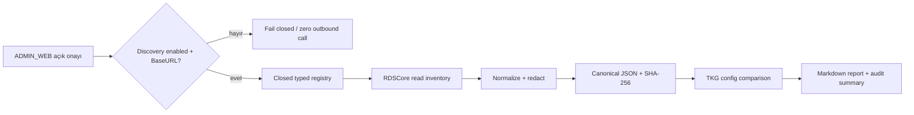

# RDSCore Commissioning Discovery

## Amaç ve sınır

Bu bileşen, üretim RDS sözleşmeleri devreye alınmadan önce RDSCore'un salt-okunur envanterini deterministik bir snapshot ve karşılaştırma raporuna dönüştürür. Robot görevi oluşturmaz, durdurmaz, kontrol komutu göndermez ve TKG workflow state'ini değiştirmez.

İki RDS yüzeyi ayrı sözleşmelerdir:

| Yüzey | TKG kullanımı | Adresleme | Yanıt yaklaşımı |
|---|---|---|---|
| RDS Web API | Mevcut WorkSite/Wind Task entegrasyonu | Sahada çoğunlukla `:8080` | Mevcut Web API envelope sözleşmesi |
| RDSCore HTTP | Commissioning discovery ve kapalı native-order adayı | Ortak, açık `RdsCore:BaseUrl`; SEER referansında çoğunlukla `:8088` | Endpoint'e göre `code: 0`, codesuz nesne veya doğrudan dizi |

`8088` üretim için garanti değildir. RDSCore adresi RDS Web API adresinden port değiştirilerek türetilmez; commissioning sırasında açıkça yapılandırılır.

## Güvenli yapılandırma

```json
{
  "RdsCore": {
    "BaseUrl": "",
    "TimeoutSeconds": 5,
    "AllowInsecureRemoteHttp": false
  },
  "RdsCoreDiscovery": {
    "Enabled": false
  }
}
```

- Varsayılan durum kapalıdır; boş BaseURL ile discovery çalışmaz.
- BaseURL yalnız `scheme://host:port/` biçiminde bir HTTP(S) origin olabilir. Kullanıcı bilgisi, path, query ve fragment reddedilir.
- Loopback dışındaki düz HTTP, ancak commissioning için açık override ile kabul edilir.
- Tanılama ve audit yalnız sanitize edilmiş origin'i (`scheme://host:port`) taşır; credential, request body veya response body normal loglara yazılmaz.
- Capture API'si yalnız `ADMIN_WEB` JWT policy'sine açıktır ve body'de `confirmReadOnlyDiscovery: true` ister.
- `RdsCoreExecution:Enabled` ayrı ve varsayılan kapalı bir sınırdır. Discovery'nin etkin olması native-order mutation yetkisi vermez.

## Kapalı endpoint registry'si

Discovery API'si `method + path + JSON` proxy sunmaz. Endpoint ve HTTP metodu private enum/registry tarafından seçilir.

Varsayılan envanter:

| Metot | Endpoint | Semantik |
|---|---|---|
| GET | `/robotsStatus` | Robot kimliği, durum, alarm ve map kanıtı |
| POST | `/binCheck` | Bütün bin/WorkSite ve binTask kanıtı; yalnız burada `{"bins":[]}` bilinçli read-all anlamındadır |
| GET | `/devicesDetails` | Door/lift/terminal/wind-shower durumu |
| POST | `/getRobotParkPoints` | Park noktaları; `{"vehicles":[]}` read-all keşif çağrısıdır |
| GET | `/getChargeParam` | Robot bazlı şarj parametreleri |
| GET | `/getDisablePoints` | Devre dışı point listesi |
| GET | `/getDisablePaths` | Devre dışı path listesi |

Yalnız açıkça istenebilen typed probe'lar:

| Metot | Endpoint |
|---|---|
| POST | `/getCoreParam` |
| POST | `/queryConnectivity` |
| POST | `/queryDist` |
| GET | `/orderDetails/{id}` |
| GET | `/orderDetailsByExternalId/{externalId}` |
| GET | `/blockDetailsById/{blockId}` |

`/getCoreParam` yeteneği typed registry'de vardır fakat onaylı plugin/parameter allowlist'i şimdilik boştur. Boş konfigürasyon dökümü yapılmaz ve snapshot `selectedCoreParameters.status = NOT_CAPTURED` üretir. Allowlist ancak RDS/IT tarafından gerekli tam plugin ve parametre adları onaylandıktan sonra kod incelemesiyle genişletilir.

`/setOrder`, `/terminate`, `/setForkHeight`, `/controlMotion`, `/setRobotIO`, `/setCoreParam` ve diğer mutation endpoint'leri registry'de yoktur; crafted path ile erişilebilen public transport metodu bulunmaz. `RdsExecutionClient` bu bileşenin dışındadır.

## Capture akışı



HTTP 2xx tek başına Core başarısı sayılmaz. Nesnede business `code` varsa yalnız `0` başarıdır. Codesuz nesneler ve dokümante doğrudan diziler geçerlidir. HTTP/404, timeout, connection ve malformed JSON hataları ilgili endpoint sonucu olarak tutulur; diğer güvenli envanter çağrıları devam eder.

API:

```http
POST /api/v1/admin/rds/commissioning/capture
Authorization: Bearer <ADMIN_WEB JWT>
Content-Type: application/json

{"confirmReadOnlyDiscovery":true}
```

İsteğe bağlı typed probe alanları `connectivityProbes`, `distanceProbes`, `orderIds`, `externalOrderIds` ve `blockIds`'dir. Serbest endpoint veya HTTP metodu alanı yoktur.

## Karşılaştırma sınıfları

- `BLOCKER`: Var olduğu açıkça yapılandırılmış bir production sözleşmesi RDS snapshot'ında yok/geçersizdir.
- `GAP`: TKG veya müşteri/site kararı eksiktir; bu otomatik olarak RDS arızası değildir.
- `WARNING`: Kanıt mevcuttur fakat commissioning riski vardır (ör. eşlenmiş point disabled).
- `INFO`: Envanter kanıtıdır (ör. TKG slotuna eşlenmemiş RDS bin'i).
- `NOT_EVALUATED`: Karşılaştırma için onaylı expected contract/source-of-truth yoktur.

Şu durumlar bilinçli olarak `NOT_EVALUATED` kalır:

- expected robot mapping yoksa robot uyumluluğu;
- operation→binTask commissioning contract yoksa binTask yeterliliği;
- Core parameter allowlist boşsa selected Core parameters.

Explicit expected robot veya required binTask sözleşmesi ileride sağlanır ve karşılığı snapshot'ta bulunmazsa sonuç `BLOCKER` olur. RDSCore `uuid` canonical keşif kimliğidir; `vehicle_id` ayrıca korunur. WP-30 yeni expected-robot tablosu üretmez.

## Değişmeden kalan veri boşlukları

Discovery; 48 Part↔Slot boşluğunu, 74 container ilişkisini, SEALER V3 layout'unu, EMPTY_STORAGE kararını, REMOVE_FULL destination'ı, container dimension/category konularını, 23 lot değerini veya HAOS/HMTR uyuşmazlığını çözmez. Gerçek bir snapshot yalnız RDS kanıtı sağlar; müşteri master data kararı uydurmaz.

## Test ve kullanım sınırı

Otomatik testler yalnız mock HTTP/fixtures kullanır. Canlı RDS, simulator veya robot hareketi bu work package içinde çalıştırılmaz. Snapshot üretimi şema migration'ı gerektirmez ve DB migrations değişmeden kalır.
