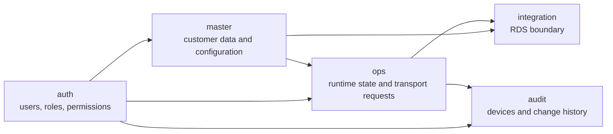
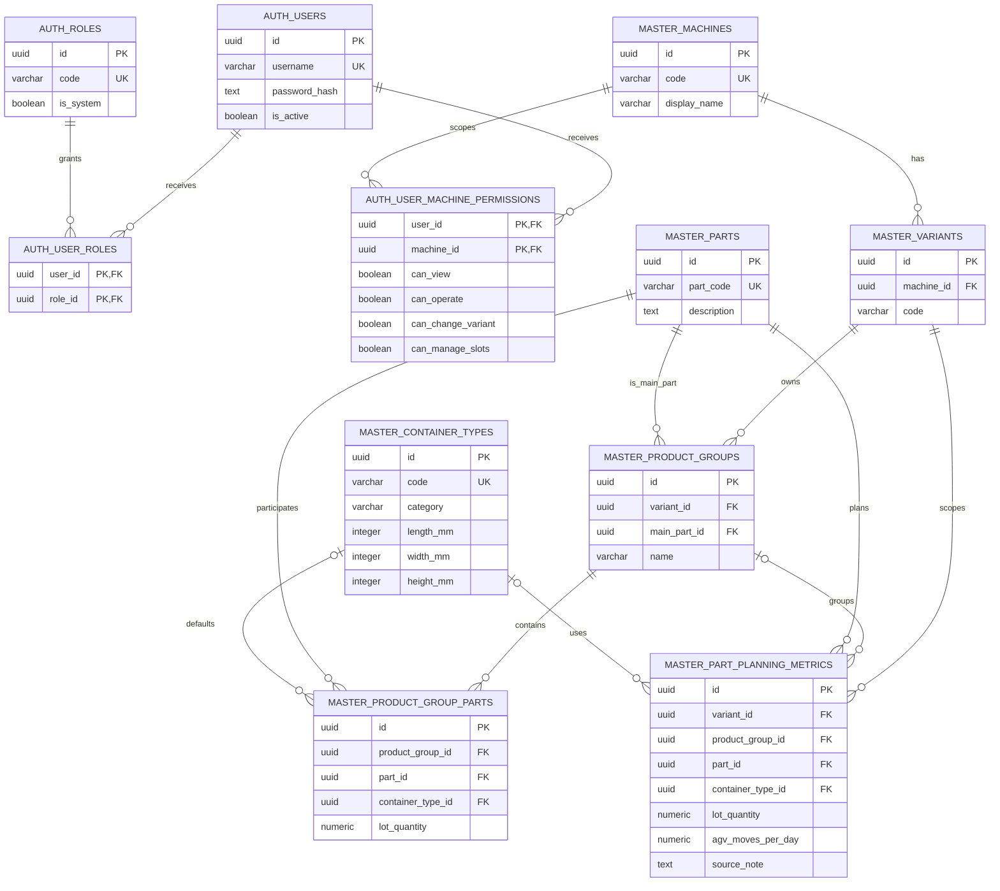
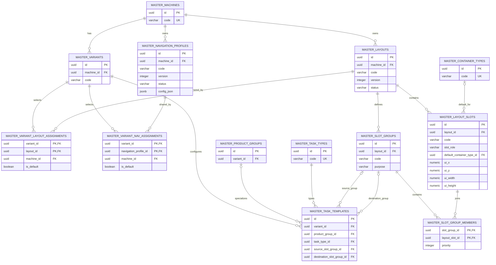
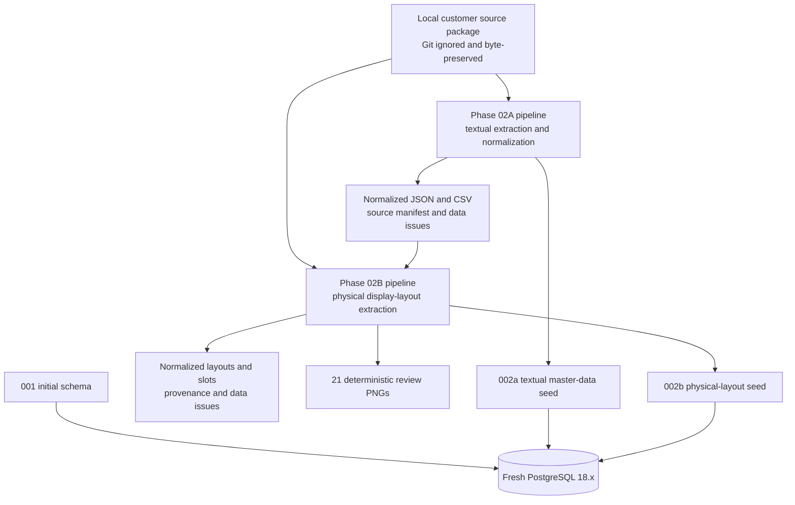

# TKG PDA Database ERD

Bu belge, `db/migrations/001_initial_schema.sql` ile kabul edilmiş Phase 01–02B baseline'ını gösterir. Okunabilirlik için model beş Mermaid diyagramına ayrılmıştır. Diyagramlarda teknik audit timestamp alanlarının bir bölümü gösterilmez; FK yönleri ve domain sınırları migration ile aynıdır.

> Phase 03 workflow engine kabul edilip `main` dalına alınmıştır. Phase 04 authenticated API mevcut `auth`, `ops` ve `audit` tablolarını migration değiştirmeden kullanır; workflow mutasyonlarını `TransportWorkflowService` üzerinden yürütür. `integration` tabloları hâlâ gelecekteki RDS akışı içindir; robot koordinatı, rota veya navigation profile üretilmez.

## 1. Şema sınırları



## 2. Kimlik, makine ve textual master data



Planning satırlarında grup nullable'dır. Uniqueness iki partial index ile sağlanır:

- grup varsa `(variant_id, product_group_id, part_id)`,
- grup yoksa `(variant_id, part_id)`.

## 3. Layout, navigation ve task template modeli



Assignment tabloları fiziksel layout/navigation profile ile üretim variant'ı arasında zorunlu 1:1 bağı önler. Aynı machine kapsamındaki bir layout birden fazla variant tarafından paylaşılabilir.

### Slot rolü güvenlik sınırı

`MASTER_LAYOUT_SLOTS.slot_role` değeri `MACHINE`, `STAGING`, `EMPTY_STORAGE`, `FULL_STORAGE`, `WAREHOUSE`, `PICKUP`, `DROP`, `SHARED` veya `OTHER` olabilir. Phase 02B baseline'ında 172 lojistik slot ve 11 `MACHINE` bölgesi vardır.

`MACHINE` bölgeleri yalnızca ekran/fiziksel referanstır. Aşağıdaki kural Phase 03'te domain validation ile uygulanmalıdır:

```text
transport source/destination slot => slot_role != 'MACHINE'
```

Migration bu bakım turunda değiştirilmemiştir.

## 4. Runtime, RDS boundary ve audit

```mermaid
erDiagram
    MASTER_MACHINES ||--o| OPS_MACHINE_RUNTIME_STATE : has_state
    MASTER_VARIANTS o|--o{ OPS_MACHINE_RUNTIME_STATE : active_variant
    MASTER_LAYOUTS o|--o{ OPS_MACHINE_RUNTIME_STATE : active_layout
    MASTER_NAVIGATION_PROFILES o|--o{ OPS_MACHINE_RUNTIME_STATE : active_navigation
    AUTH_USERS o|--o{ OPS_MACHINE_RUNTIME_STATE : selected_by

    MASTER_LAYOUT_SLOTS ||--o| OPS_SLOT_RUNTIME_STATE : has_state
    MASTER_CONTAINER_TYPES o|--o{ OPS_SLOT_RUNTIME_STATE : current_container
    MASTER_PARTS o|--o{ OPS_SLOT_RUNTIME_STATE : current_part

    AUTH_USERS o|--o{ OPS_TRANSPORT_REQUESTS : requests
    MASTER_MACHINES ||--o{ OPS_TRANSPORT_REQUESTS : scopes
    MASTER_VARIANTS ||--o{ OPS_TRANSPORT_REQUESTS : scopes
    MASTER_LAYOUTS ||--o{ OPS_TRANSPORT_REQUESTS : uses
    MASTER_NAVIGATION_PROFILES o|--o{ OPS_TRANSPORT_REQUESTS : uses
    MASTER_TASK_TYPES ||--o{ OPS_TRANSPORT_REQUESTS : types
    MASTER_LAYOUT_SLOTS o|--o{ OPS_TRANSPORT_REQUESTS : source_or_destination
    OPS_TRANSPORT_REQUESTS ||--o{ OPS_TRANSPORT_REQUEST_EVENTS : records
    AUTH_USERS o|--o{ OPS_TRANSPORT_REQUEST_EVENTS : acts

    MASTER_NAVIGATION_PROFILES o|--o{ INTEGRATION_RDS_WORKSITES : scopes
    MASTER_LAYOUT_SLOTS ||--o| INTEGRATION_SLOT_RDS_MAPPING : maps
    INTEGRATION_RDS_WORKSITES ||--o| INTEGRATION_SLOT_RDS_MAPPING : maps
    OPS_TRANSPORT_REQUESTS ||--o| INTEGRATION_RDS_TASKS : mirrors

    AUTH_USERS o|--o{ AUDIT_AUDIT_LOGS : acts
    AUDIT_CLIENT_DEVICES o|--o{ AUDIT_AUDIT_LOGS : emits

    OPS_MACHINE_RUNTIME_STATE {
        uuid machine_id PK,FK
        uuid active_variant_id FK
        uuid active_layout_id FK
        uuid active_navigation_id FK
        bigint row_version
    }
    OPS_SLOT_RUNTIME_STATE {
        uuid layout_slot_id PK,FK
        varchar occupancy_state
        varchar load_state
        uuid current_container_type_id FK
        uuid current_part_id FK
        bigint row_version
    }
    OPS_TRANSPORT_REQUESTS {
        uuid id PK
        bigint request_no UK
        varchar idempotency_key UK
        uuid machine_id FK
        uuid variant_id FK
        uuid layout_id FK
        uuid task_type_id FK
        uuid source_slot_id FK
        uuid destination_slot_id FK
        varchar status
    }
    OPS_TRANSPORT_REQUEST_EVENTS {
        bigint id PK
        uuid transport_request_id FK
        uuid actor_user_id FK
        varchar event_type
        varchar old_status
        varchar new_status
    }
    INTEGRATION_RDS_WORKSITES {
        uuid id PK
        uuid navigation_profile_id FK
        varchar rds_site_id
        integer last_filled
        varchar last_agv_id
        jsonb raw_state_json
    }
    INTEGRATION_SLOT_RDS_MAPPING {
        uuid layout_slot_id PK,FK
        uuid rds_worksite_id FK
    }
    INTEGRATION_RDS_TASKS {
        uuid id PK
        uuid transport_request_id UK,FK
        varchar rds_task_record_id UK
        varchar rds_task_label
        varchar out_order_no
        varchar agv_id
        integer rds_status
    }
    AUDIT_CLIENT_DEVICES {
        uuid id PK
        varchar device_code UK
        varchar device_type
    }
    AUDIT_AUDIT_LOGS {
        bigint id PK
        uuid actor_user_id FK
        uuid device_id FK
        varchar action
        varchar entity_type
        varchar entity_id
        uuid correlation_id
    }
    AUTH_USERS {
        uuid id PK
    }
    MASTER_MACHINES {
        uuid id PK
    }
    MASTER_VARIANTS {
        uuid id PK
    }
    MASTER_LAYOUTS {
        uuid id PK
    }
    MASTER_NAVIGATION_PROFILES {
        uuid id PK
    }
    MASTER_LAYOUT_SLOTS {
        uuid id PK
        varchar slot_role
    }
    MASTER_CONTAINER_TYPES {
        uuid id PK
    }
    MASTER_PARTS {
        uuid id PK
    }
    MASTER_TASK_TYPES {
        uuid id PK
    }
```



`integration.rds_worksites.navigation_profile_id` bilinçli olarak nullable tutulmuştur. Global/warehouse WorkSite domain kararı verilmeden constraint değiştirilmemiştir. Phase 02A/02B seed'leri RDS WorkSite veya RDS task kaydı üretmez.

## 5. Deterministik veri üretim zinciri



DB uygulama sırası `001_initial_schema.sql` → `002a_customer_textual_master_data.sql` → `002b_customer_physical_layouts.sql` şeklindedir. Seed'ler tekrar uygulanabilir ve ikinci uygulama mantıksal veritabanı durumunu değiştirmez.
